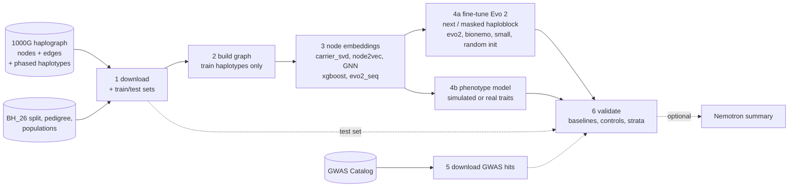

# GenoPheno Embedding Validator: documentation

The repository is a pipeline in two parts:

- **Part 1, [`part1_haplograph/`](part1_haplograph/):** 1000 Genomes haplograph → phased haplotypes as token sequences → node embeddings → fine-tuning Evo 2 (on haplotypes, and on phenotypes) → validation on held-out test individuals against baselines and controls. Most of this document is about part 1.
- **Part 2, [`part2_proteomics/`](part2_proteomics/):** paired tumor/normal proteomics → protein embeddings (ProLM) → fusion with the genome model. See [section 9](#9-part-2-proteomics) and the READMEs in its folders.

The short version is in [README.md](README.md). **How to install the dependencies and run the pipeline is at the end: [section 10](#10-installation) and [section 11](#11-running-the-pipeline).**

Contents: [1 What part 1 does](#1-what-part-1-does) · [2 The haplograph](#2-key-concepts-the-haplograph) · [3 Working directory](#3-working-directory-structure) · [4 Script reference](#4-script-reference) · [5 Split and leakage](#5-the-traintest-split-and-leakage-protection) · [6 GPU acceleration](#6-gpu-acceleration-rapids-cupy-bionemo-nemotron) · [7 Extending](#7-extending-the-pipeline) · [8 Results and limitations](#8-results-and-limitations) · [9 Part 2](#9-part-2-proteomics) · [10 Installation](#10-installation) · [11 Running](#11-running-the-pipeline)

## 1. What part 1 does

Haploblock clusters discretize the genome into a vocabulary of inherited haplotype states. Part 1 tests one hypothesis: **graph embeddings of these states, fed to the DNA foundation model Evo 2 in place of nucleotide tokens, let Evo 2 learn haplotype structure that generalizes to haplotypes it has never seen**, and Evo 2's pretraining is what makes the difference. The pipeline therefore builds the task on phased haplotypes (one token per haploblock), gives the model an output head without a cross-entropy floor, and judges it on held-out individuals against count-based baselines (frequency, n-grams, a Li-Stephens HMM) and against two controls: Evo 2's architecture with random weights, and a small transformer trained from scratch.



| Step | Script | In one sentence |
|---|---|---|
| 1 | `1_download_haplograph.py` | Downloads the haplograph and each haplotype's cluster per haploblock, checks them, and writes the training and test sets, populations and related pairs. |
| 2 | `2_build_graph.py` | Builds one graph (genome-wide or selected chromosomes) from same-haplotype co-occurrence on the training haplotypes, plus the haplotype and transition tables. |
| 3 | `3_node_embeddings.py` | Turns every graph node into a vector (carrier_svd, node2vec, GNN; XGBoost and evo2_seq on request); `--rapids` runs the SVDs on the GPU. |
| 4a | `4a_finetune_evo2_embeddings.py` | Fine-tunes Evo 2 7B on training haplotypes, one token per haploblock (no DNA): next-haploblock or masked-haploblock prediction; controls `--init random` and `--backbone small`. |
| 4b | `4b_finetune_evo2_phenotype.py` | Fine-tunes Evo 2 to predict a phenotype from both haplotypes (traits simulated on the real haplotypes, or real ones); `--input hash` is the unlinked-hash baseline. |
| 5 | `5_download_gwas.py` | Downloads the GWAS Catalog and writes the reported hits of one trait (GRCh38, like the haplograph) for step 6. |
| 6 | `6_validate_evo2.py` | Validates fine-tuned models on the test individuals (predictions against baselines and controls, imputation, phenotypes, GWAS, recombination, embeddings, leakage, plus your own checks). |

Shared code: `haplo_common.py` (downloads, individual lists, training set, device selection, the synthetic block-HMM data of `--test`), `evo2_model.py` (genome data, the Evo 2 / BioNeMo / small backbones, the 4a and 4b models, `load_finetuned`, and the training loop) and `haplo_baselines.py` (frequency, n-gram and Li-Stephens HMM predictors).

## 2. Key concepts: the haplograph

The haplograph describes how haplotype states are shared across the 2,548 individuals of the 1000 Genomes data. There is one set of files per chromosome (chr1–chr22; chrX and chrY are not in the dataset).

**Haploblocks and clusters.** Each chromosome is divided into **haploblocks**, recombination-defined stretches written as `chr21_14215892-14284114` (chromosome, start and end in bp, GRCh38). Within each haploblock the haplotypes are grouped into **clusters** of similar sequences; each cluster is one node, `chr21_14215892-14284114_cluster1`. Most clusters are rare: on chr21 the median support is 1 (166,754 clusters in 597 haploblocks).

**Phased haplotypes.** Each individual has two haplotypes, and each haplotype carries exactly one cluster per haploblock (the dataset's per-haploblock files list the cluster of each of the 5,096 haplotypes; cluster index + 1 = the node's `cluster<N>`). So a haplotype is a sequence of one token per haploblock, in genomic order, and the same position means the same haploblock for every haplotype. The individual-level view (`nodes.csv.gz`: which individuals carry a cluster on either haplotype) loses phase and dosage: on chr21, 62% of (individual, haploblock) pairs carry two different clusters.

**Edges and lift.** An edge connects two clusters of the **same chromosome**, at most `--max-span` bp apart, that sit on the same training haplotype more often than expected:

```
lift = n_AB × H / (n_A × n_B)        (H training haplotypes; n_A haplotypes with A, n_AB with both)
```

A lift of 1 is chance level, above 1 means the clusters tend to be inherited together (in cis). Each edge stores `log(1 + lift)`; edges below `--min-lift` or seen on fewer than `--min-pair-count` training haplotypes are dropped. The individual-level alternative (`--lift individual`) counts co-carriage by the same individual (either haplotype) for the pairs of the dataset's edge file, which mixes cis and trans pairs.

## 3. Working directory structure

Everything is written under one root folder, `haplograph/` by default (`--workdir` of steps 1 and 2), inside the folder you run the scripts from. A **graph folder** holds one graph and everything derived from it; steps 3, 4 and 6 point at it with `--graph-dir`.

```
haplograph/
├── raw/                               step 1 downloads (largest part)
│   ├── checksums.md5, verified.json     (files already MD5-checked: re-runs skip re-hashing them)
│   ├── phenotypes_real.csv, pedigree.txt
│   ├── chr1/ nodes.csv.gz, edges.csv.gz, haplotypes.csv.gz [, rep_seq.tar.gz, rep_seq.md5]
│   └── ...
├── splits/                            step 1
│   ├── train_individuals.txt          TRAINING set, one sample ID per line
│   ├── test_individuals.txt           TEST set
│   ├── populations.tsv                individual, superpopulation, population
│   ├── related_pairs.tsv              individual_a, individual_b, relation, across_split
│   ├── split.json                     split name, source, sizes, set ids, superpopulations per set, related pairs
│   └── half_A.txt, half_B.txt         (BH_26 originals)
├── gwas/                              step 5
│   ├── <label>.tsv, <label>.json      GWAS hits of one trait (CHR, POS, SNP, P, PUBMEDID)
│   └── catalog/                       the downloaded GWAS Catalog zip (cached)
├── parts/                             per-chromosome cache (step 2), reused across graphs
└── genome_train_half_A/               one GRAPH FOLDER  (= --graph-dir for steps 3, 4 and 6)
    ├── nodes.csv.gz, individuals.txt, carriers.npz, graph.npz, graph_info.json    step 2
    ├── haplotypes.npz, junctions.npz                                              step 2
    ├── train_individuals.txt, test_individuals.txt, populations.tsv, related_pairs.tsv   step 2
    ├── features_svd128_<set id>_<graph id>_s<seed>[_rapids].npy   step 3 (cache)
    ├── node_emb_<method>.npy / .json            step 3 (+ .csv.gz with --csv)
    ├── evo2_seq_cache/<id>/<haploblock>.npz     step 3 evo2_seq
    ├── <backbone>[-random]_<objective>_<method>.pt     step 4a, e.g. evo2_next_gnn.pt, small_masked_gnn.pt
    ├── <backbone>_pheno_<trait>_<method>.pt     step 4b
    ├── phenotypes/<trait>_train.tsv, _test.tsv, _answer.json   step 4b --simulate
    └── validation_<model name>/                 step 6: report.md, summary.json, split.csv, one CSV per task,
                                                 nemotron_summary.md, inputs/ (downloads)
```

Graph folder names: `genome` (all 22 chromosomes) or e.g. `chr21_chr22` (a selection), plus `_train_<split name>` (`half_A` for BH_26, e.g. `random50_seed0` for a random split, or the stem of a `--train-individuals` file).

## 4. Script reference

Only the main options are listed; `--help` shows all of them, and each script's header documents its output formats. Every script has **`--test`**, which runs it on a small synthetic haplograph (2 chromosomes, 60 individuals, drawn from a known block-HMM) on the CPU in seconds; the test outputs go to `<system temp>/haplograph_selftest/`. Steps 3, 4a and 4b take the training set from the graph's `train_individuals.txt` and stop on any other.

### Step 1: `1_download_haplograph.py`

Downloads `nodes.csv.gz` and the edge file of each chromosome from `https://data.haploblocks.org/haplograph/1000G/<chrom>/` and checks them against `checksums.md5`. With `--haplotypes`, it downloads `<chrom>_individual_hashes_<haploblock>.tsv` from `haploblock_hashes/1000G/<chrom>/` for every haploblock (the last 20 bits of each haplotype's hash are its cluster index), checks each downloaded file against `haploblock_hashes/1000G/all_chr_tsv_webserver.md5`, checks that every haplotype of every individual has exactly one cluster that exists in the haplograph, and writes `raw/<chrom>/haplotypes.csv.gz`. It writes the train/test split restricted to the haplograph's individuals, each individual's population (`phenotypes_real.csv`; used only to stratify step 6, never as a model input) and the parent-child and sibling pairs of the 1000 Genomes pedigree (BH_26 on the 2,548 haplograph individuals: none).

| Option | Default | Meaning |
|---|---|---|
| `--chroms` | all (chr1–chr22) | e.g. `chr21,chr22` or `21,22` |
| `--haplotypes` | off | download each haplotype's cluster per haploblock (needed by steps 2–6 with haplotype units) |
| `--sequences` | off | download each cluster's representative sequence, `rep_seq.tar.gz` (step 3 `evo2_seq`; 3.1 GB for chr21) |
| `--edges` | `all` | `lift5` = small pre-filtered file (lift ≥ 5); `both` (only used by `--lift individual`) |
| `--split` | `bh26` | BH_26 halves (`half_A` train, `half_B` test); `random` = new split, related individuals on one side |
| `--test-fraction`, `--seed` | `0.5`, `0` | random split; stratified by 1000G population unless `--no-stratify` |
| `--workdir` | `haplograph` | output root |
| `--jobs` | `8` | parallel downloads of the per-haploblock files |
| `--no-verify` | off | skip the MD5 check |

Usage (more in [section 11](#11-running-the-pipeline)):

```bash
python 1_download_haplograph.py --test                        # test: synthetic haplograph + split
python 1_download_haplograph.py --chroms chr21 --haplotypes   # test: one chromosome
python 1_download_haplograph.py --haplotypes                  # full run: whole genome, BH_26 split
```

### Step 2: `2_build_graph.py`

Merges the chromosomes into one graph. Everything learned from data comes from the training individuals only (the split of step 1, or `--train-individuals`; `--no-split` uses all individuals). With `--lift haplotype` (the default when every chromosome has `haplotypes.csv.gz`) the candidate pairs and their counts come from the training haplotypes; with `--lift individual` they come from the dataset's edge file and are re-weighted on the training individuals.

With haplotype data, step 2 also writes `haplotypes.npz` (int32 [2 × individuals, haploblocks]: row 2i / 2i+1 = haplotype 0 / 1 of individual i, value = node index; all individuals, because step 6 needs the test rows) and `junctions.npz` (`block`, `a`, `b`, `count`: training haplotypes with node a in haploblock column `block` and node b in the next one). The build stops unless every individual's two haplotypes reproduce its carriers in `nodes.csv.gz` exactly.

If the graph folder already exists, step 2 compares the requested settings with its `graph_info.json`: identical settings reuse the graph, different ones stop with the differences listed. `--force` rebuilds in place (steps 3 and 4 then notice the new build), `--out` writes a new folder.

- **Out** (in the graph folder): `nodes.csv.gz` (`node`, `id`, `chrom`, `region`, `start`, `end`, `support`, `support_train`), `individuals.txt`, `train_individuals.txt`, `test_individuals.txt`, `populations.tsv`, `related_pairs.tsv`, `carriers.npz` (sparse [nodes × individuals]), `graph.npz` (sparse [nodes × nodes], `log(1 + lift)`), `haplotypes.npz`, `junctions.npz`, `graph_info.json` (settings, counts, `pair_source`, training / test sets).

| Option | Default | Meaning |
|---|---|---|
| `--chroms` | every downloaded chromosome | e.g. `chr21,chr22` |
| `--lift` | `haplotype` with haplotype data, else `individual` | same-haplotype or same-individual co-occurrence |
| `--max-span` | `500000` | `--lift haplotype`: max bp between linked haploblocks (start to start) |
| `--min-pair-count` | `3` | `--lift haplotype`: min training haplotypes carrying both clusters |
| `--min-lift` | `2.0` | drop weaker edges |
| `--train-individuals` | the split of step 1 | training set file or URL |
| `--no-split` | off | build from all individuals |
| `--workdir`, `--raw-dir`, `--out` | `haplograph`, `<workdir>/raw`, automatic | locations |
| `--cudf`, `--chunksize` | off, `2000000` | `--lift individual`: read the edge files on the GPU with RAPIDS cuDF; rows per chunk (`0` = whole file) |

Usage (more in [section 11](#11-running-the-pipeline)):

```bash
python 2_build_graph.py --test                      # test: synthetic data
python 2_build_graph.py --chroms chr21              # test: -> haplograph/chr21_train_half_A
python 2_build_graph.py                             # full run: whole genome -> haplograph/genome_train_half_A
```

### Step 3: `3_node_embeddings.py`

Learns one vector per node, by default with carrier_svd, node2vec and the GNN (`--method all`, or e.g. `--method gnn,xgboost`). No phenotype or population labels are used.

| Method | Uses | How |
|---|---|---|
| `carrier_svd` | carriers | the SVD-compressed profile of which training individuals carry the node: the GNN's (and XGBoost's) input, kept as the reference graph methods must beat in step 6 |
| `node2vec` | graph | random walks along edges, then skip-gram (nodes close on walks get similar vectors) |
| `gnn` | graph + carrier_svd | 2-layer graph convolutional network trained to predict which nodes are connected |
| `xgboost` | graph + carrier_svd | trees predict each node's **cis partner** in the next haploblock (the frequency rank, within that haploblock, of the cluster that most often follows it on a training haplotype; `--xgb-classes` classes); the leaves a node falls into become its vector. Not in `--method all` (see section 8) |
| `evo2_seq` | sequences (GPU) | Evo 2 at `--layer`, mean-pooled over each cluster's representative haplotype sequence (`--seq-windows` windows of `--seq-window` bp), centred within its haploblock (clusters of one haploblock differ by a few variants) and reduced to `--dim` by PCA. Defined for every cluster, including those never seen in training; cached per haploblock so a run can resume. Needs step 1 `--sequences`; costs one Evo 2 pass per cluster (chr21: 167k) |

- **Out:** `node_emb_<method>.npy` (float32 [nodes × dim], row *i* = node *i*), `node_emb_<method>.json` (settings, a training summary, the training set and the graph build), `node_emb_<method>.csv.gz` with `--csv`.

| Option | Default | Meaning |
|---|---|---|
| `--method` | `all` | a method, a comma-separated list, or `all` (carrier_svd, node2vec, gnn) |
| `--dim` | `64` | embedding size |
| `--p`, `--q` | `1.0`, `1.0` | node2vec: low `p` keeps walks local, low `q` makes them explore |
| `--walks-per-node`, `--walk-length` | `10`, `40` | node2vec walk budget (CPU-bound) |
| `--gnn-epochs` | `300` | GNN training length |
| `--xgb-trees`, `--xgb-depth`, `--xgb-classes` | `50`, `6`, `8` | XGBoost; the model has `--xgb-trees` × classes trees |
| `--seq-window`, `--seq-windows`, `--raw-dir` | `8192`, `1`, `<graph-dir>/../raw` | evo2_seq; backbone options as in step 4a |
| `--device` | cuda if available | `cpu` / `cuda` |
| `--rapids` | off | carrier and leaf SVDs on the GPU with RAPIDS cuML + CuPy (see section 6) |

Usage (more in [section 11](#11-running-the-pipeline)):

```bash
python 3_node_embeddings.py --test                  # test: synthetic data (every method, small backbone for evo2_seq)
python 3_node_embeddings.py --graph-dir haplograph/chr21_train_half_A --device cpu --walks-per-node 2 --gnn-epochs 50   # test: chr21, CPU
python 3_node_embeddings.py --graph-dir haplograph/genome_train_half_A --device cuda --rapids                           # full run: GPU
```

### Step 4a: `4a_finetune_evo2_embeddings.py`

Fine-tunes Evo 2 7B on node embeddings, with no DNA involved.

- **Units.** With `--units haplotype` (default) one example is one training haplotype on one chromosome, exactly one token per haploblock, so token offset = haploblock offset for every example. `--units individual` uses every cluster an individual carries (1 or 2 per haploblock, in file order) and needs `--softmax all`.
- **Tokens.** Each token is the node's embedding with the haploblock's log length and a **genomic-position encoding** appended (sin / cos of the cluster's start at `--pos-freqs` wavelengths from 10 kb to the graph's largest start, standardized like the embedding), projected into Evo 2 in place of its DNA-letter embeddings, plus a learned per-chromosome vector. Clusters carried by fewer than `--min-support` training haplotypes share one "rare cluster of this haploblock" token (embedding = mean of its members), counted on step 4a's own training individuals.
- **Objective.** `--objective next` predicts each haploblock's cluster from the ones before it (causal, like Evo 2's pretraining). `--objective masked` replaces spans of 1..`--mask-max` haploblocks (`--mask-frac` of the tokens) by a learned mask vector plus the haploblock's position and length, runs Evo 2 on the haplotype and on its reverse, and predicts each masked cluster from the two states concatenated (left and right context).
- **Head and softmax.** `--softmax block` (default with haplotype units) scores only the clusters of the target's haploblock, which is exact for haplotype units and leaves "which cluster" without "where". `--head scaled-cosine` (default) = cosine similarity to each candidate's embedding times a learned logit scale (log scale initialised at log 10, clamped to [0, log 100]); `--head table` = a learned output vector and bias per token, initialised from the embeddings; `--head cosine` = a fixed `--temperature`. Step 6's `head_ceiling` reports the floor each head leaves: near 0 for gnn, carrier_svd and xgboost keys on chr21, but 0.16 at the largest scale for node2vec (isolated nodes keep near-identical untrained vectors), so use `--head table` with node2vec.
- **Backbone and controls.** Evo 2 runs up to its read-out layer; its last `--train-blocks` blocks (default 4) are fine-tuned, the rest stay frozen. Evo 2 is kept in bf16, so the optimizer steps on fp32 master copies of the trainable weights. `--init random` replaces Evo 2's pretrained weights with a seeded random init (same architecture and trainable budget): modules with their own initializer are re-initialised, every other parameter (norm scales, Hyena filters) is shuffled within its tensor, keeping its value distribution; `--backbone small` is a causal transformer with sinusoidal token positions trained from scratch (`--small-hidden` 512, `--small-layers` 6, every block trained at `--head-lr`). Each checkpoint records its trainable parameter count.
- **Training.** AdamW (`--lr` for Evo 2's blocks, `--head-lr` for the new layers), `--batch` sequences per step, `--epochs` (default 3), evaluation every `--eval-every` steps and after every epoch; the parameters of the lowest validation loss are kept (the untrained ones if training never improves on them). The training state (fp32 weights, optimizer, random state, settings) is saved to `<out>.resume` after every evaluation; `--resume` continues from it and refuses a file written with other settings (only `--epochs` and logging may change). Only training individuals are used, split again into train and validation (`--val-frac`).
- **`--smoke`** loads the backbone, runs one forward / backward on 16 tokens, checks that gradients reach the input projection and the trainable blocks, reports the peak memory and the seconds per step at `--max-len`, and exits.

| Backbone | Flag | Notes |
|---|---|---|
| Evo 2 via the `evo2` package | `--backbone evo2` (default) | one CUDA GPU (80 GB recommended); `--evo2-model`, `--layer` |
| Evo 2 via NVIDIA BioNeMo | `--bionemo` / `--backbone bionemo` | **experimental, not yet run on a GPU**; inside the BioNeMo container, NeMo2 checkpoint in `--ckpt-dir`, `--model-size` (default `7b`), `--layer-index` (default `28`); code that may need adjusting for your BioNeMo version is marked `VERSION-SENSITIVE` in `evo2_model.py` |
| small transformer | `--backbone small` | trained from scratch; the baseline for "pretraining helps", and the CPU model of every `--test` |

- **In:** `nodes.csv.gz`, `individuals.txt`, `haplotypes.npz` (or `carriers.npz` with individual units), `node_emb_<method>.npy` + `.json`.
- **Out:** `<backbone>[-random]_<objective>_<method>[_individual].pt`, a torch dict (CPU tensors): `trained_blocks` (the trained backbone parameters; the whole small backbone), `proj_in`, `chrom_emb`, `head_layers`, `extra` (mask vector, logit scale or output table); `backend`, `init`, `units`, `objective`, `head`, `softmax`, `graph_method`, `chroms`, `graph_id`, `embeddings_sha1`; `train_individuals`, `val_individuals`, `train_set_id`; `trainable_params`; `metrics` (`before`, `best`, `last`, `best_step`, `history`) and `config`.

| Option | Default | Meaning |
|---|---|---|
| `--method` | required | which embeddings |
| `--units` | `haplotype` | `individual`: the carriers view (for comparison) |
| `--objective` | `next` | `masked`: masked-haploblock prediction from both sides |
| `--head`, `--softmax` | `scaled-cosine`, `block` | see above |
| `--backbone`, `--init` | `evo2`, `pretrained` | `small`, `bionemo`; `random` |
| `--train-blocks` | `4` (all for small) | backbone blocks to train; `0` = frozen backbone (only the new layers train) |
| `--lr`, `--head-lr` | `1e-5`, `1e-3` | learning rates of Evo 2's blocks and of the new layers (and the small backbone) |
| `--batch`, `--epochs` | `8`, `3` | sequences per optimizer step; passes over the training sequences |
| `--max-len` | `1024` | max tokens per sequence |
| `--pos-freqs` | `16` | genomic-position encoding (`0` = none) |
| `--min-support` | `2` | merge clusters carried by fewer training haplotypes (`0` = no merging) |
| `--mask-frac`, `--mask-max` | `0.15`, `3` | masked objective |
| `--eval-every`, `--resume`, `--smoke` | `200`, off, off | see above |

Usage (more in [section 11](#11-running-the-pipeline)):

```bash
python 4a_finetune_evo2_embeddings.py --test        # test: synthetic data, small backbone
python 4a_finetune_evo2_embeddings.py --method gnn --graph-dir haplograph/chr21_train_half_A --backbone small --device cpu   # test: chr21, CPU
python 4a_finetune_evo2_embeddings.py --method gnn --graph-dir haplograph/genome_train_half_A                               # full run: Evo 2, GPU
```

### Step 4b: `4b_finetune_evo2_phenotype.py`

Fine-tunes Evo 2 to predict a phenotype from an individual's genome. With `--input tokens` (default) both haplotypes of every chromosome are step-4a tokens, each run through the backbone; their states are attention-pooled per chromosome, the chromosome vectors attention-pooled into one genome vector, and a head predicts the phenotype (regression for numbers, classification for labels). Every haploblock is read, in windows of `--max-len` tokens. `--init-from` starts from a step-4a checkpoint (its backbone blocks and input projection) and refuses one trained on other embeddings, `--init`, `--pos-freqs`, `--min-support` or base model. `--input hash` is the "unlinked hash" baseline: a 0/1 genomic hash per row (`--hash-pheno`), cut into tokens of `--hash-bits` bits (one haploblock hash each), so the model sees cluster identities without the haplograph's linkage.

1000 Genomes has no measured traits beyond ancestry and sex, so `--simulate` draws one on the graph's real haplotypes:

| Trait | Genetic value |
|---|---|
| `additive` | `--causal-blocks` haploblocks, one causal cluster each (training frequency 5–50%), effect N(0, 1) per copy |
| `cis` | `--causal-blocks` pairs of neighbouring haploblocks with a cluster pair (a, b) found together on 5–50% of training haplotypes; the effect counts the haplotypes that carry a AND b, so a and b on different haplotypes of one individual do nothing (an additive model of cluster dosages cannot represent it exactly) |
| `null` | none |

The phenotype is the genetic value scaled to heritability `--h2` plus Gaussian noise, written to `phenotypes/<trait>_train.tsv` (training individuals only, the file 4b trains on), `_test.tsv` (for step 6) and `_answer.json` (causal haploblocks, clusters, effects). `--phenotype FILE` takes real values of training individuals instead; a file with test individuals is refused.

- **Out:** `<backbone>[-random]_pheno_<trait>_<method>.pt` (hash input: next to the TSV): `mode` "phenotype", `input`, `task`, `trait`, `target_mean` / `target_std`, the trained parameters, `train_individuals`, `val_individuals`, `metrics`, `config`.

Usage (more in [section 11](#11-running-the-pipeline)):

```bash
python 4b_finetune_evo2_phenotype.py --test                                       # test: simulated cis trait, small backbone
python 4b_finetune_evo2_phenotype.py --graph-dir $G --method gnn --simulate cis   # full run: Evo 2, GPU
```

### Step 5: `5_download_gwas.py`

Downloads the [NHGRI-EBI GWAS Catalog](https://www.ebi.ac.uk/gwas/docs/file-downloads) (`gwas-catalog-associations_ontology-annotated-full.zip`, all reported associations with p < 1e-5) into `gwas/catalog/` and keeps the associations of one trait (`--trait` and `--trait-id` together select the union). Rows placed on several loci or not placed on GRCh38 are dropped, and a variant reported by several studies is kept once, with its lowest p-value. The haplograph's regions match the hg38 HaploHash blocks (`part2_proteomics/data/`), so catalog positions (GRCh38) need no liftover.

- **Out:** `gwas/<label>.tsv` (columns `CHR`, `POS`, `SNP`, `P`, `PUBMEDID`) and `gwas/<label>.json` (source, catalog sha1 and file date, `genome_build`, filter, matching associations, rows dropped as multi-locus or unplaced, variants, studies). Body height: 45,250 associations from 68 studies, 6,895 dropped, 29,486 variants.

| Option | Default | Meaning |
|---|---|---|
| `--trait` | none | regular expression on `MAPPED_TRAIT` / `DISEASE/TRAIT`, case-insensitive (e.g. `"^body height$"`) |
| `--trait-id` | none | comma-separated ontology IDs, the last part of `MAPPED_TRAIT_URI` (e.g. `OBA_VT0001253`; `OBA:VT0001253` also works); also matches associations mapped to several traits |
| `--label` | from the filter | output file name (letters, digits, `.`, `_`, `-`) |
| `--catalog` | latest release URL | catalog zip, https URL or local file |
| `--workdir`, `--force` | `haplograph`, off | output root; download the catalog again |

Usage (more in [section 11](#11-running-the-pipeline)):

```bash
python 5_download_gwas.py --test                                    # test: synthetic catalog, planted hotspot
python 5_download_gwas.py --trait "^body height$" --label height    # full run: body height
```

### Step 6: `6_validate_evo2.py`

Validates fine-tuned models on the test set. By default it uses the graph folder's `train_individuals.txt` / `test_individuals.txt`; `--splits DIR_OR_URL` reads `half_A.txt` / `half_B.txt` from elsewhere, and `--splits none` uses the model's own validation individuals. It warns if any test individual was used to build the graph or to train or validate a model. `--model` can be repeated: `model_comparison` uses every model, the other tasks the first (or the one in their `model=` parameter). The checks to run are listed in a tasks file, one per line ([`validation_tasks.txt`](part1_haplograph/validation_tasks.txt)):

```
model_info
test_set_performance max_examples=500 train_examples=200
head_ceiling
embedding_cooccurrence min_lift=2 min_support=5 min_expected=5 pairs=50000
cluster_consistency min_carriers=1 permutations=200
gwas_enrichment gwas=haplograph/gwas/height.tsv pvalue=5e-8 clump=auto label=height
model_gwas gwas=haplograph/gwas/height.tsv pvalue=5e-8
junction_strength
```

| Task | Checks |
|---|---|
| `model_info` | model type, backbone, init, units, objective, head, trainable parameters, stored metrics and best step, train/test leakage |
| `test_set_performance` | **queries the fine-tuned model** (next-token objective) on test haplotypes: cross-entropy, perplexity, top-1 / top-5, against **baselines counted on the training haplotypes**: frequency (also the identity-free baseline for haplotype units), add-k smoothed bigram, trigram with backoff and a Li-Stephens HMM (copying the training haplotypes, switch and error rates fitted on held-out training haplotypes); with individual units, identity-free (the current token's haploblock and slot, not its identity) and bigram. 95% CIs of the model and of model − each baseline from a paired bootstrap over test individuals (`beats_baselines`); the same on a sample of training individuals (generalization gap); the bigram reference entropy and the head's floor. `test_set_performance_strata.csv`: every metric by target training frequency (< 1%, 1–5%, 5–20%, > 20%), superpopulation, haploblock-length tertile, merged-rare target and (individual units) same- vs next-haploblock target, with the model's CI and the CIs of model − each baseline (top-1, and cross-entropy for haplotype units). Needs the backbone used in step 4a (a GPU for Evo 2 / BioNeMo) |
| `head_ceiling` | the head's floor: the cross-entropy of an oracle that chooses the best query direction for each target (optimised by gradient descent), at the current and at the largest logit scale; the cross-entropy when pointing exactly at the target's key; how collinear the keys are (cosine to the nearest other key). A learned table has no floor |
| `masked_imputation` | masked-objective model: `per_individual` non-overlapping spans of exactly 1, 2, 5 haploblocks (`spans`, an observed haploblock between spans) masked on both haplotypes of test individuals; concordance and r² of the cluster dosage (pooled per training-frequency bin) for the model, the HMM (forward-backward), a flank lookup (training haplotypes matching both flanking clusters) and the frequency, with paired CIs of model − each |
| `model_comparison` | every `--model` scored on the same test examples (top-1, cross-entropy), with paired CIs between every pair; models are loaded one at a time; a pair is compared only if both predict the same targets at the same positions (same readout, units, softmax, merging, windows and masks) |
| `embedding_cooccurrence` | **held-out test of the step-3 embeddings, no GPU**: for distinct cluster pairs in different haploblocks (≤ `max_distance` bp apart, ≥ `min_support` test occurrences each, ≥ `min_expected` co-occurrences expected), ROC AUC of embedding cosine similarity for pairs that co-occur on the same TEST haplotype (`labels=haplotype`, default with haplotype data; lift ≥ `min_lift`) vs pairs that don't (lift ≤ 1); overall, within distance and frequency bins, on pairs without graph edges, and minus carrier_svd's AUC with a paired CI; references: genomic proximity, cluster frequency, the training haplotypes' lift; the 95% CIs resample haploblocks |
| `cluster_consistency` | per haploblock: do train and test individuals carry the same clusters at the same frequencies (permutation null); related pairs across the split |
| `gwas_enrichment` | GWAS hits (p < `pvalue`) clumped into independent loci (`clump=auto`: 25 kb for hit lists, 250 kb for summary statistics). **Per haploblock:** more loci than expected, for a hit list from the haploblock's length (Poisson), for full summary statistics from the SNPs tested in it (hypergeometric); Benjamini-Hochberg q. **Two nulls**, `permutations` draws each: loci moved to random places (empirical FDR), and all hits rotated along the chromosome with their spacing kept (calls that clusters of correlated hits alone produce; a warning when it exceeds twice the first). **Same haploblock:** hit pairs that share a haploblock vs the rotations. Positions must be GRCh38: a file whose `.json` names another build is refused, and more than 5% of SNPs outside the haploblock span gives a warning |
| `model_gwas` | a 4a model's per-haploblock scores (mean surprisal and entropy of its predictions on test haplotypes, dispersion of the haploblock's cluster embeddings) at GWAS-hit haploblocks vs `matched` background haploblocks each (same chromosome, nearest in length, number of clusters and cluster entropy), with a CI resampling the hit haploblocks and, within each, its matched set, and p-values under the two nulls of `gwas_enrichment`; reports how many hit haploblocks have fewer than `matched` candidates |
| `phenotype_prediction` | a 4b regression model (token input): test R² against ridge regression with an intercept on cluster dosages (λ by generalized cross-validation), with paired CIs; with an answer key, recall of the causal haploblocks among those each method ranks first (ridge: sum of its weights; model: mean attention) |
| `junction_strength` | Spearman correlation between the recombination rate between neighbouring haploblocks (GRCh38 genetic map, default Beagle's) and the next haploblock's unpredictability: the training haplotypes' conditional entropy, and the model's mean prediction entropy; CI resampling chunks of neighbouring boundaries |

- **Out:** in `validation_<model name>/`: `report.md`, `summary.json`, `split.csv`, one CSV per task, and `nemotron_summary.md` with `--nemotron-summary`. A failed task makes step 6 exit with code 1.

| Option | Default | Meaning |
|---|---|---|
| `--model` | required | fine-tuned model; repeat for `model_comparison` |
| `--tasks` / `--task` | model_info + test_set_performance (or masked_imputation) + head_ceiling + embedding_cooccurrence + cluster_consistency (+ model_comparison with several models) | tasks file / one task line |
| `--gwas` | none | adds a `gwas_enrichment` line for this file to the tasks |
| `--splits` | `graph` | `graph`, a folder or URL with `half_A.txt` / `half_B.txt`, or `none` |
| `--plugins` | none | Python file(s) with extra tasks |
| `--cudf` | off | read its tables on the GPU with RAPIDS cuDF |
| `--nemotron-summary` | off | plain-language summary by an NVIDIA Nemotron model (section 6) |

`--list-tasks` shows every task with its parameters.

Usage (more in [section 11](#11-running-the-pipeline)):

```bash
python 6_validate_evo2.py --test      # test: steps 1-6 on synthetic data, every task
G=haplograph/genome_train_half_A
python 6_validate_evo2.py --model $G/evo2_next_gnn.pt --graph-dir $G --tasks validation_tasks.txt   # full run: Evo 2, GPU
```

## 5. The train/test split and leakage protection

The pipeline is designed so the test individuals never influence anything that is trained:

| Step | What comes from the training individuals only | What still contains everyone, and why |
|---|---|---|
| 1 | (writes the split; related individuals stay on one side of a random split) | |
| 2 | same-haplotype counts, lift, candidate pairs, `--min-lift` filtering, junction counts | `carriers.npz`, `haplotypes.npz` (step 6 needs the test rows) |
| 3 | carrier features, graph, cis-partner targets (all methods); evo2_seq uses sequences only | none |
| 4a / 4b | the individuals trained and validated on; rare-cluster merging; simulated phenotypes of the training file | the simulated test phenotypes (written for step 6 only) |
| 5 | (GWAS hits: no individuals) | |
| 6 | baselines (counted on the training haplotypes); checks the rest, then evaluates on the test individuals | |

Each step stores the training set's id and the graph build's id and the next step checks them: steps 3, 4a and 4b refuse any training set other than the graph's own; step 4a stops if the embeddings came from another training set or graph build; step 4b refuses a phenotype file with test individuals; step 3 recomputes automatically if the graph, training set or its settings changed; step 6 refuses a model trained on another graph build or other embeddings, and `embedding_cooccurrence` marks embeddings made from another training set as not held-out. Step 6 only loads checkpoints with `torch.load(weights_only=True)`, so a model file can't run code. With `--lift individual`, the *list* of candidate pairs comes from the dataset's edge file, which was made from all individuals (weights and filtering are train-only); `--lift haplotype` avoids that.

## 6. GPU acceleration: RAPIDS, CuPy, BioNeMo, Nemotron

The pipeline detects the GPU itself (torch and XGBoost use CUDA when available; `--device cpu` forces the CPU for the small backbone and step 3). The NVIDIA tools are optional extras:

| Tool | Where | What it does |
|---|---|---|
| RAPIDS cuDF | steps 2 and 6, `--cudf` | runs their pandas code on the GPU (cuDF's pandas accelerator), falling back to the CPU for anything cuDF doesn't support. In step 2 (`--lift individual`) add `--chunksize 0` so the edge files are parsed on the GPU |
| RAPIDS cuML + CuPy | step 3, `--rapids` | carrier-matrix SVD and XGBoost leaf-basis SVD on the GPU |
| XGBoost (CUDA) | step 3 | tree training on the GPU (`--device cuda`, automatic when available) |
| NVIDIA BioNeMo | steps 3 (evo2_seq), 4a, 4b, `--bionemo` | loads and runs Evo 2 through NeMo 2 / Megatron Core |
| NVIDIA Nemotron (NIM) | step 6, `--nemotron-summary` | plain-language interpretation of the validation report |

**RAPIDS in step 3.** Step 3 is CPU/RAM-bound, not GPU-bound, so `--rapids` is not a large speedup: it accelerates the two SVDs only. The carrier SVD is fitted on a `--rapids-fit-rows` sample (default 150k) and applied in `--rapids-chunk` dense chunks (default 200k); the sampling is an approximation, so raise `--rapids-fit-rows` (e.g. 300000) to get closer to the exact CPU SVD (the carrier matrix has only ~1,250 training columns, so a larger sample is cheap). The cached features are stored separately for `--rapids` (`features_svd*_rapids.npy`), so the CPU and GPU SVDs never mix.

**Nemotron.** `--nemotron-summary` sends the task summaries of the report to an NVIDIA Nemotron model on an OpenAI-compatible NIM endpoint and writes the answer to `nemotron_summary.md`. Only aggregate numbers are sent: sample IDs (`HG…`/`NA…` and the graph's own individual names) and the directories of file paths are removed, and file names are dropped. The key is only sent over https (or to localhost), and redirects are not followed. Defaults: `--nemotron-url https://integrate.api.nvidia.com/v1` (build.nvidia.com; or a self-hosted NIM) and `--nemotron-model nvidia/llama-3.3-nemotron-super-49b-v1` (change it if the catalogue has moved on). The API key is read from `$NVIDIA_API_KEY`. Without a key, or if the request fails, step 6 prints a warning and still writes its report.

## 7. Extending the pipeline

- **Another validation run** (other trait, threshold or settings): add a line to the tasks file.
- **A new validation check:** write a function in a plugin file and load it with `--plugins my_checks.py`.

  ```python
  @task("mean_clusters_per_individual", "Average number of clusters per test individual")
  def mean_clusters(ctx, min_support: int = 1):
      n = ctx.graph.carriers[:, ctx.test_idx].sum(axis=0)
      return {"summary": {"mean": float(n.mean())}}
  ```

  A task receives `ctx` plus its parameters (typed by their annotations) and returns a `summary` dict, plus optional `notes` and `files`. Useful parts of `ctx`: `ctx.graph.nodes`, `ctx.graph.carriers`, `ctx.graph.regions`; `ctx.train_idx`, `ctx.test_idx`; `ctx.model.meta` (the first checkpoint) and `ctx.models`; `ctx.out(name)` (a path for an output file).
- **A check that queries the fine-tuned model:** `model, data, meta = query_model(ctx)` rebuilds it (cached across tasks); `model.score(chrom, example)` returns per-prediction target, log-probability, top-1 / top-5 and entropy (`example` = haplotype row, `2 * individual + h`), `model.score(chrom, example, mask=positions, probs=True)` the distributions at masked positions. `haplo_baselines.BlockBaselines` gives the count-based predictions on the same tokens.
- **A new backbone** (another DNA foundation model): write a runner class in `evo2_model.py` with `net`, `dev`, `hidden_in`, `hidden_out`, `trainable`, `run_soft()` and `run_ids()` (see `SmallRunner` for the smallest example), and select it in `make_runner()`.
- **A new model type in step 6:** add a rule to `model_kind()`.
- **A new embedding method:** write `embed_<name>(args, A)` in step 3 that returns a [nodes × dim] array and a summary dict, add it to `METHODS` in `haplo_common.py` and to the dispatch dict in `run_method()`.
- **Another dataset:** change `BASE_URL`, `HASHES_URL` and `ALL_CHROMS` in `haplo_common.py` (same file layout), or put the files in `<workdir>/raw/<chrom>/` yourself together with `splits/split.json`, `train_individuals.txt` and `test_individuals.txt`.

## 8. Results and limitations

### What has and has not been run

On a CPU-only machine (Apple M5, 16 GB RAM, Python 3.9, torch 2.8, xgboost 2.1), the pipeline ran on the real chr21 data with the BH_26 split (1,252 train / 1,251 test individuals):

| Step | Result | Time |
|---|---|---|
| 1 | chr21 downloaded (~85 MB), MD5 verified; `--haplotypes`: 5,096 haplotypes × 597 haploblocks, every haplotype one cluster that exists in the haplograph; split written (45 haplograph individuals in neither half; 0 related pairs) | ~2 min |
| 2 | 166,754 nodes; the two haplotypes of every individual reproduce its carriers exactly; `--lift haplotype`: 89,147 edges from 2.5 M same-haplotype pairs, 148,857 isolated nodes (`--lift individual`: 1,520,370 edges, 161,937 isolated) | ~15 s |
| 3 | carrier_svd, node2vec, GNN (CPU, reduced settings `--walks-per-node 2 --walk-length 20 --window 3 --gnn-epochs 50`) | ~20 s |
| 4a | `--backbone small --small-hidden 256 --small-layers 4`, haplotype units, next-haploblock, scaled-cosine head, 3 epochs (3.2 M trainable parameters): validation loss 3.54 → 1.66, top-1 0.11 → 0.56 | 4 min |
| 5 | GWAS Catalog downloaded (~73 MB), body height: 45,250 associations from 68 studies → 29,486 variants | ~50 s |
| 6 | see below | ~1 min |

**Step 6 on chr21** (`test_set_performance max_examples=1000`: 1,000 test haplotype sequences of 800 test individuals, 596,000 predictions; 95% CIs from a paired bootstrap over test individuals):

| | top-1 | cross-entropy | model − baseline, top-1 |
|---|---|---|---|
| small backbone | 0.562 (0.559–0.565) | 1.670 | |
| frequency (= identity-free) | 0.492 | 1.652 | +0.070 (0.068–0.071) |
| bigram | 0.555 | 1.528 | +0.007 (0.006–0.008) |
| trigram | 0.573 | 1.491 | −0.011 (−0.012 to −0.010) |
| Li-Stephens HMM | 0.592 | 1.354 | −0.031 (−0.033 to −0.029) |

The small backbone learns more than frequency and position (it beats the identity-free baseline, so the learning setup works on real haplotypes), and slightly more than the bigram, but not the trigram or the HMM, and its cross-entropy is worse than every baseline's (its probabilities are not calibrated after 3 CPU epochs; the head's floor at its learned logit scale is 0.06 and 0.0001 at the largest scale, so the head is not the limit). Generalization gap: 0.012 (top-1 on training haplotypes 0.573). With individual units (the carriers view), the baselines are identity-free 0.393 and bigram 0.436 in the central 256-token window the individual-units model was trained with (`--max-len 256`); over whole sequences 0.405 and 0.435. Evo 2 has to beat the HMM and the trigram, and this small backbone, to support the hypothesis.

**Embeddings on held-out haplotypes** (`embedding_cooccurrence`, haplotype labels, 2,478 pairs, 126 positive, ≥ 5 expected test co-occurrences): GNN 0.941 (0.911–0.964), XGBoost 0.832, node2vec 0.812, carrier_svd 0.810, against 0.982 for the lift counted on the training haplotypes, 0.627 for genomic proximity and 0.365 for cluster frequency. Only the GNN beats its own input features (AUC − carrier_svd +0.130, 0.093–0.186; XGBoost +0.022 and node2vec +0.002, CIs including 0). On the individual-lift graph the GNN reaches 0.875 (+0.065), so `--lift haplotype` is the default.

**Recombination and GWAS on chr21.** `junction_strength` (Beagle's GRCh38 map, 596 boundaries): the next haploblock is harder to predict where recombination between the two is more frequent, both in the training haplotypes' transitions (Spearman ρ 0.129, 0.050–0.208) and in the small backbone's predictions (ρ 0.132, 0.052–0.198). `model_gwas` (body height, 131 loci in 105 haploblocks): the small backbone's surprisal, prediction entropy and the embeddings' dispersion at hit haploblocks do not differ from matched background (differences 0.006, 0.016, 0.005, CIs including 0). `masked_imputation`, `phenotype_prediction` and `model_comparison` were run on synthetic data only (tests and `--test`), not on chr21.

Every script's `--test` passes, and the positive controls on the synthetic block-HMM pass (`tests/test_controls.py`): the small backbone's next-haploblock cross-entropy on test haplotypes is within 10% of the true generating model's, and a masked-objective small backbone imputes single haploblocks with 0.95× the concordance of the Li-Stephens HMM. **Not run, because no GPU was available:** Evo 2 itself (the `evo2` package; so `--init random` on Evo 2, `--smoke` on a GPU and `evo2_seq` with Evo 2), the BioNeMo backbone (written against the BioNeMo API, never executed), RAPIDS `--cudf` / `--rapids`, XGBoost on CUDA, `setup.py --evo2` beyond a dry run, and the Nemotron request against the real NVIDIA endpoint (tested against a local fake endpoint). Expect to fix small API or version issues on first real runs, especially in the parts marked `VERSION-SENSITIVE`.

### Modelling assumptions

- **Evo 2 was trained on DNA, never on these inputs.** Steps 4a and 4b replace its nucleotide inputs with projected graph embeddings. What is tested is whether its architecture and weights are a useful starting point; whether its DNA knowledge transfers is what `evo2_seq` (embeddings from the clusters' own sequences) addresses. The controls `--init random` and `--backbone small` separate the two.
- **Between-haploblock linkage is weak by construction**: haploblocks are cut where recombination occurs, so the next haploblock is only partly predictable from the previous ones; the n-gram and HMM baselines show how much is.
- **Edges exist only within chromosomes.** The genome-wide graph is 22 disconnected pieces; node2vec vectors can't be compared across chromosomes (step 4a adds a per-chromosome vector), and training sequences are per chromosome.
- **Most nodes are rare.** On chr21 the median cluster is carried by one individual; at the default `--min-support 2`, clusters seen on fewer than 2 training haplotypes share one token per haploblock. Clusters only seen in the test set have embeddings but the model never trained on them; only `evo2_seq` gives them an embedding from data the model has not seen labelled.
- **XGBoost is not in `--method all`.** Its cis-partner target is close to its majority-class baseline on chr21 (accuracy 0.474 vs 0.469), and its embeddings do not beat carrier_svd in `embedding_cooccurrence` (AUC difference +0.02, CI including 0).
- **Phenotypes are simulated.** 1000 Genomes has no measured traits beyond ancestry and sex; the phenotype claim is tested on traits simulated on the real haplotypes (step 4b), where the answer is known.

### Data and leakage

- **Genome build.** The haplograph README doesn't state the build of its coordinates, but its regions are identical to the hg38 HaploHash blocks of `part2_proteomics/data/` (e.g. `chr21_14215892-14284114` holds RBM11 at its hg38 position), and on chr21 only 1.3% of GWAS Catalog (GRCh38) height hits fall outside the haploblock span. Summary statistics in hg19 (e.g. GIANT 2022) must be lifted over first. Because the haploblocks tile the chromosomes, hg19 positions still land inside haploblocks and give plausible but wrong results; step 6 warns when more than 5% of the SNPs fall outside the haploblock span.
- **Related individuals.** The 1000 Genomes pedigree lists no parent-child or sibling pairs among the 2,548 haplograph individuals (individuals sharing a family ID there are unrelated co-founders), so BH_26 has no related pairs across the split; a relatedness task has no ground truth in these data. Cryptic relatedness not in the pedigree is not checked.
- **`--edges lift5`** was pre-filtered on all individuals; with `--lift individual` use `--edges all`.
- **2,548 vs 2,503 individuals.** 45 graph individuals are in neither BH_26 half and are left out of training and validation.
- **Step 4b's `--phenotype` file** must contain training individuals only; step 4b refuses test individuals.

### Statistical caveats in step 6

- **Baselines are counted on the training individuals**, the model on its own training individuals (a subset: the rest is its validation set), so the baselines see slightly more data than the model.
- **Chi-square assumption.** `cluster_consistency`'s chi-square test treats carrier counts as independent, but one person can carry two clusters of the same haploblock. The permutation-based columns don't rely on that and are the ones to trust.
- **Correlated GWAS hits.** Hits in linkage disequilibrium (one locus reported by several studies, or several SNPs of one signal) are not independent. Counted one by one (`clump=0`), body height on chr21 gives 8 haploblocks with q < 0.05; moving loci at random gives 0.01 by chance (empirical FDR 0%), but rotating all hits with their spacing kept gives 7.9 (FDR 99%, and step 6 warns): the apparent enrichment is the clustering of hits, not the haploblocks. With the default 25 kb (216 hits → 128 loci) no haploblock is enriched (rotation: 0.0; at 10 kb, 155 loci, ~0.15-0.17). Distance clumping is a proxy for LD: in simulations with LD-like clusters it gave no false calls at ≥ 25 kb for hit lists, some at 10 kb, and for summary statistics some at 25 kb and none at 100 kb or 250 kb, hence the 250 kb default there. The rotation null also moves real clusters of independent loci together, so a high rotation count says "dense cluster", not "false".
- **Power.** After clumping, a haploblock can hold at most about its length / `clump` + 1 loci: at 25 kb only ~7% of chr21 haploblocks can reach a Bonferroni-level p (67% at 10 kb), so the per-haploblock test detects only strong multi-locus enrichment (in simulations, 10 planted loci in a 341 kb haploblock: 19/20 detected at 25 kb, 6 loci: 1/20). For summary statistics at the default 250 kb no chr21 haploblock (longest 341 kb, median 41 kb) can reach it at all; step 6 says so, and the same-haploblock test is then the informative one.
- **Genome-wide GWAS test.** The haploblocks tile whole chromosomes, so "are hits inside haploblocks" can't be tested (step 6 notes this when they cover > 95% of the span). The same-haploblock test replaces it: on chr21, 361 hit pairs share a haploblock vs ~295-296 under rotation (p ≈ 0.07-0.09). It is calibrated (~4-5% at p < 0.05 with shuffled haploblock boundaries) but has modest power on one chromosome; whole-genome runs give more. It counts unclumped hit pairs, so large clusters weigh most.
- **`test_set_performance`** evaluates the central `--max-len` window of each sequence (the same windows as step 4a's validation) on a sample of `max_examples` sequences; raise it for tighter estimates.

### Scale and performance

- **Data size.** The edge files (only for `--lift individual`) are up to about 1 GB per chromosome, the haplotype tables a few MB per chromosome (about 0.5 MB downloaded per haploblock), the representative sequences several GB per chromosome.
- **Host RAM, not the GPU, is the bottleneck of steps 2–3** at genome scale (11M nodes). With `--method xgboost`, its leaf stage is the peak; lower `--xgb-trees`, `--xgb-classes` or `--xgb-depth` if step 3 is killed.
- **GNN memory.** The GNN runs on the whole graph at once on one device; very large graphs may not fit.
- **node2vec speed.** Its walks run on CPU (numpy), which can be slow for genome-wide graphs; lower `--walks-per-node` or `--walk-length`.
- **Step 4a.** It uses one GPU (or the CPU for the small backbone). With `--softmax block` memory grows with `--max-len` × the largest haploblock's tokens, not with the chromosome's; `--objective masked` runs the backbone twice per example. `--resume` continues an interrupted run from its last evaluation.
- **Permutation cost.** Step 6's permutations and the HMM baseline (one pass per training haplotype and haploblock) multiply runtime; lower `permutations` or `max_examples` for quick runs.

## 9. Part 2: proteomics

Each part 2 folder has its own README with installation and usage.

| Folder | What | Language |
|---|---|---|
| [`part2_proteomics/proteomics_prep/`](part2_proteomics/proteomics_prep/) | places proteins in haploblocks, tumor − normal per protein and patient, node/edge CSVs; example and testthat tests (`run_example.sh`, `run_tests.sh`) | R |
| [`part2_proteomics/synthtan_prolm/`](part2_proteomics/synthtan_prolm/) | converts the synthetic SynthTAN v0.1 cohorts to ProLM's input format | Python |
| [`part2_proteomics/proteomics_emb/`](part2_proteomics/proteomics_emb/) | ProLM fine-tuning from scratch, one embedding per patient (`finetune.py`, run from inside a ProLM install; notebook `finetune_on_synthetic_data.ipynb`) | Python |
| [`part2_proteomics/data/`](part2_proteomics/data/) | gene-to-haploblock map (GENCODE v50 on 39,074 hg38 blocks) | TSV |
| [`part2_proteomics/clinical_dashboard/`](part2_proteomics/clinical_dashboard/) | `ProteoOnset.html`, a clinical dashboard prototype | HTML |

The fusion with the genome model (early vs late fusion with the Evo 2 of part 1) is designed but not implemented; see the README.

## 10. Installation

Part 1 has a CPU core (all steps, with `--backbone small` in steps 3, 4a and 4b) and GPU extras (Evo 2, BioNeMo, RAPIDS). Run everything from `part1_haplograph/`.

### 10.1 CPU only (any OS; checks the whole pipeline, no Evo 2)

```bash
cd part1_haplograph
python setup.py --venv ~/haplograph-env  # numpy, pandas, scipy, torch, xgboost (requirements.txt); or omit --venv
source ~/haplograph-env/bin/activate
python 6_validate_evo2.py --test         # runs steps 1-3, 4a, 5 and 6 on synthetic data; should end with "self-test checks passed"
```

`setup.py` prints one line per step and the version of every package it installed; when a command fails it shows that command's last output lines and a hint (`--verbose` shows all output, `--dry-run` only prints the commands). On macOS, XGBoost needs the OpenMP runtime (`brew install libomp`; `setup.py` says so if the import fails). For a smaller CPU-only torch on Linux: `pip install torch --index-url https://download.pytorch.org/whl/cpu` before `setup.py`.

### 10.2 GPU with Evo 2 (Linux, NVIDIA GPU, CUDA 12.8)

`python setup.py --evo2` checks the system (Linux, `nvidia-smi`, a driver for CUDA ≥ 12.8, compute capability ≥ 8.0, the Python), installs the CUDA 12.8 toolkit (Ubuntu, apt with sudo) and adds `CUDA_HOME` to `~/.bashrc` once, creates a venv in `~/evo2-env` with pip build tools and torch 2.7.1 (cu128), installs flash-attn 2.8.0.post2 (compiled from source on Blackwell, for the detected architecture), clones the `evo2` repository and installs it (light install, no Transformer Engine) and `requirements.txt`, imports every package and runs Evo 2's generation test:

```bash
cd part1_haplograph
python3 setup.py --evo2                  # auto-detects the GPU
python3 setup.py --evo2 --gpu rtx        # or force RTX PRO 6000 Blackwell (sm_120) / --gpu l40s (sm_89)
source ~/evo2-env/bin/activate
```

| Option | Environment variable | Default | Meaning |
|---|---|---|---|
| `--python` | `PYTHON` | `python3.12` | Python that creates the venv (3.11 or 3.12) |
| `--venv` | `VENV` | `~/evo2-env` | venv location |
| `--evo2-src` | `EVO2_SRC` | `~/evo2-src` | where the evo2 repository is cloned |
| `--evo2-ref` | `EVO2_REF` | `main` | evo2 tag or commit (a release tag makes the install reproducible) |
| `--max-jobs` | `MAX_JOBS` | `4` | parallel flash-attn compile jobs (more = faster, more RAM) |
| `--skip-cuda-toolkit` | `SKIP_CUDA_TOOLKIT=1` | off | CUDA 12.8 is already installed in `/usr/local/cuda-12.8` |
| `--skip-evo2-test` | `SKIP_EVO2_TEST=1` | off | skip the generation test (it downloads the `evo2_7b_base` weights, ~15 GB) |
| `--gpu` | | `auto` | `auto` reads the compute capability from `nvidia-smi`; `rtx` = RTX PRO 6000 Blackwell (sm_120, flash-attn built from source), `l40s` = L40S (sm_89) |
| `--dry-run` | | off | print the commands without running them (the GPU and driver checks still run) |
| `--verbose` | | off | stream the full output of every command |

`PYTHON` and `VENV` (`--python`, `--venv`) also apply to the CPU mode of 10.1. On sm_120 (Blackwell) `setup.py` sets `FLASH_ATTENTION_FORCE_BUILD=TRUE` and `FLASH_ATTN_CUDA_ARCHS`, so flash-attn is compiled for the GPU instead of downloading a prebuilt wheel. evo2 is installed from its git repository at `--evo2-ref` (a branch is checked out at its latest remote state), with torch kept at the CUDA 12.8 build.

Requirements: Linux, Python 3.11 or 3.12 (the CPU core of 10.1 also runs on Python ≥ 3.9), NVIDIA driver for CUDA 12.8 (≥ 570), an 80 GB GPU recommended for 7B. Manual equivalent:

```bash
pip install numpy pandas scipy torch xgboost
pip install flash-attn==2.8.0.post2 --no-build-isolation
pip install evo2          # setup.py installs evo2 from git at --evo2-ref instead
```

### 10.3 RAPIDS (cuDF, cuML, CuPy) in its own venv

**RAPIDS goes in its own venv; the Evo 2 environment stays clean.** Installing RAPIDS into the same site-packages can downgrade the CUDA bindings (`cuda-bindings`, `cuda-toolkit`) that a CUDA 13 PyTorch depends on to CUDA 12. PyTorch may keep working because it bundles its own CUDA libraries, but that is luck, not design. Keep two environments:

- **RAPIDS venv active** (`(rapids-env)` in the prompt): steps 2 and 6 with `--cudf`, step 3 with `--rapids`.
- **Evo 2 venv active**: step 4, and everything without RAPIDS flags.

Check the prompt before every run. Without conda, the CUDA 12 RAPIDS pip wheels (`-cu12`) are the route:

```bash
sudo apt install -y python3-venv             # if venv creation fails (needs sudo)
python3 -m venv ~/rapids-env
source ~/rapids-env/bin/activate
pip install --upgrade pip
pip install --extra-index-url=https://pypi.nvidia.com \
    "cudf-cu12==26.2.*" "cuml-cu12==26.2.*" "cupy-cuda12x==14.2.0" \
    -r requirements.txt
python -c "import cudf, cuml, cupy; print('cuml', cuml.__version__, '| gpu', cupy.cuda.runtime.getDeviceCount())"
# expect: cuml 26.02.000 | gpu 1
```

Verified versions (RTX PRO 6000 Blackwell, 96 GB, driver 580.126.09 / CUDA 13.0, `nvcc` 12.8, Python 3.10): `cudf-cu12 26.02.*`, `cuml-cu12 26.02.000`, `cupy-cuda12x 14.2.0`, `numpy 2.2.x`, `scipy 1.15.x`, CUDA-enabled `xgboost`.

If RAPIDS was already pip-installed into the system Python, remove it there (with the RAPIDS venv deactivated) and check that PyTorch still sees the GPU:

```bash
deactivate 2>/dev/null
pip uninstall -y cudf-cu12 cuml-cu12 cupy-cuda12x \
    libcudf-cu12 libcuml-cu12 pylibcudf-cu12 librmm-cu12 rmm-cu12 \
    libraft-cu12 pylibraft-cu12 libkvikio-cu12
python3 -c "import torch; print(torch.__version__, torch.cuda.is_available())"   # expect: ... True
# if that prints False or errors, restore the bindings PyTorch wants (CUDA 13 torch):
pip install --user --force-reinstall 'cuda-bindings>=13.0.3' 'cuda-toolkit==13.0.3'
```

### 10.4 BioNeMo (for `--bionemo`)

Run step 4 inside the BioNeMo Framework container, which provides torch, NeMo 2, Megatron Core and bionemo-evo2, and convert (or download) an Evo 2 checkpoint in NeMo2 format:

```bash
docker run --gpus all -it --rm -v "$PWD":/workspace -w /workspace/part1_haplograph \
    nvcr.io/nvidia/clara/bionemo-framework:<version> bash
pip install -r requirements.txt
evo2_convert_to_nemo2 --model-path hf://arcinstitute/savanna_evo2_7b_base --model-size 7b --output-dir nemo2_evo2_7b_8k
# or: download_bionemo_data evo2/7b-8k:1.0      (pre-converted checkpoint)
```

`--model-size` must match the checkpoint (`7b` = 8K context, `7b_arc_longcontext` = 1M context).

### 10.5 Nemotron (for `--nemotron-summary`)

Create an API key at [build.nvidia.com](https://build.nvidia.com) (or run a Nemotron NIM yourself and pass `--nemotron-url`), then `export NVIDIA_API_KEY=nvapi-...`. No extra Python package is needed.

## 11. Running the pipeline

All commands from `part1_haplograph/`.

### 11.1 Self-tests (CPU, seconds)

```bash
python 1_download_haplograph.py --test        # synthetic haplograph (known block-HMM) + split
python 2_build_graph.py --test
python 3_node_embeddings.py --test            # every method (small backbone for evo2_seq)
python 4a_finetune_evo2_embeddings.py --test   # small backbone
python 4b_finetune_evo2_phenotype.py --test   # simulated cis trait
python 5_download_gwas.py --test              # synthetic GWAS Catalog
python 6_validate_evo2.py --test              # runs steps 1-5 itself (next, masked, frozen and phenotype models), then every task
```

Tests (synthetic data, CPU, about a minute; they include the positive controls): `pip install pytest`, then from the repository root `python -m pytest part1_haplograph/tests -q`.

### 11.2 Real data on a CPU (chr21, small backbone)

```bash
python 1_download_haplograph.py --chroms chr21 --haplotypes
python 2_build_graph.py
G=haplograph/chr21_train_half_A
python 3_node_embeddings.py --graph-dir $G --device cpu --walks-per-node 2 --walk-length 20 --window 3 --gnn-epochs 50
python 4a_finetune_evo2_embeddings.py --method gnn --graph-dir $G --backbone small --small-hidden 256 --small-layers 4 --device cpu
python 5_download_gwas.py --trait "^body height$" --label height   # GWAS hits for validation_tasks.txt
python 6_validate_evo2.py --model $G/small_next_gnn.pt --graph-dir $G --tasks validation_tasks.txt
```

This trains the small backbone from scratch: it is the baseline Evo 2 must beat, and shows that the data flows through every step (section 8 has its chr21 results).

### 11.3 Real data on a GPU (Evo 2)

Start with `--chroms chr21,chr22` in steps 1–2 (`G=haplograph/chr21_chr22_train_half_A`) before the whole genome.

```bash
source ~/evo2-env/bin/activate
python 4a_finetune_evo2_embeddings.py --smoke                     # check the GPU setup first (minutes)
python 1_download_haplograph.py --haplotypes                      # whole genome, BH_26 split
python 2_build_graph.py                                           # -> haplograph/genome_train_half_A
G=haplograph/genome_train_half_A
python 3_node_embeddings.py --graph-dir $G                        # carrier_svd + node2vec + gnn
python 4a_finetune_evo2_embeddings.py --method gnn --graph-dir $G                    # evo2_next_gnn.pt
python 4a_finetune_evo2_embeddings.py --method gnn --graph-dir $G --init random      # evo2-random_next_gnn.pt
python 4a_finetune_evo2_embeddings.py --method gnn --graph-dir $G --backbone small   # small_next_gnn.pt
python 4a_finetune_evo2_embeddings.py --method gnn --graph-dir $G --objective masked # evo2_masked_gnn.pt
python 5_download_gwas.py --trait "^body height$" --label height
python 6_validate_evo2.py --model $G/evo2_next_gnn.pt --graph-dir $G --tasks validation_tasks.txt
python 6_validate_evo2.py --model $G/evo2_next_gnn.pt --model $G/evo2-random_next_gnn.pt --model $G/small_next_gnn.pt \
    --graph-dir $G --task model_comparison                                            # does pretraining help?
python 6_validate_evo2.py --model $G/evo2_masked_gnn.pt --graph-dir $G --task masked_imputation
```

Then read the result as in README step 6 ("Reading the result"): the hypothesis needs fine-tuned Evo 2 to beat the HMM and the n-grams (CI excluding 0, at least for common clusters), and both `--init random` and `--backbone small`, with a head whose floor is not the limit.

Phenotypes (simulated on the real haplotypes) and DNA-grounded embeddings:

```bash
for t in additive cis null; do
    python 4b_finetune_evo2_phenotype.py --graph-dir $G --method gnn --simulate $t --init-from $G/evo2_next_gnn.pt
    python 6_validate_evo2.py --model $G/evo2_pheno_${t}_gnn.pt --graph-dir $G --task phenotype_prediction
done
python 1_download_haplograph.py --chroms chr21 --sequences       # representative sequences (3.1 GB for chr21)
python 3_node_embeddings.py --graph-dir haplograph/chr21_train_half_A --method evo2_seq
```

With RAPIDS (in the RAPIDS venv) for steps 2, 3 and 6:

```bash
source ~/rapids-env/bin/activate
python 2_build_graph.py --lift individual --cudf --chunksize 0    # add --force if the graph already exists
python 3_node_embeddings.py --graph-dir $G --device cuda --rapids --rapids-fit-rows 300000 --force
deactivate && source ~/evo2-env/bin/activate      # step 4a in the Evo 2 environment
```

With BioNeMo (inside the container, see 10.4):

```bash
python 4a_finetune_evo2_embeddings.py --method gnn --graph-dir $G --bionemo --ckpt-dir nemo2_evo2_7b_8k
python 6_validate_evo2.py --model $G/bionemo_next_gnn.pt --graph-dir $G --tasks validation_tasks.txt
```

With a Nemotron summary of the validation:

```bash
export NVIDIA_API_KEY=nvapi-...
python 6_validate_evo2.py --model $G/evo2_next_gnn.pt --graph-dir $G --tasks validation_tasks.txt --nemotron-summary
```

At genome scale, host RAM is the limit in steps 2–3 (see section 8).
