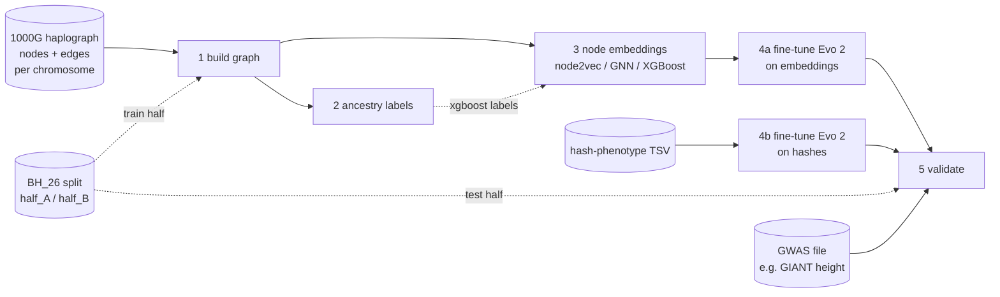

# Haplograph → Evo 2 pipeline: documentation

This document explains what the pipeline does, how to run each script, what goes in and out of every step, how to extend it, and what its current limitations are. The short version is in `README.md`.

## 1. What the pipeline does

The pipeline turns the [1000 Genomes haplograph](https://data.haploblocks.org/haplograph/1000G/) into a form Evo 2 can learn from, fine-tunes Evo 2 on it, and validates the result.



| Step | Script | In one sentence |
|---|---|---|
| 1 | `1_build_graph.py` | Downloads the haplograph and builds one graph (genome-wide or selected chromosomes), with edge weights computed from the training individuals. |
| 2 | `2_ancestry_labels.py` | Labels individuals and graph nodes with super-population ancestry (needed for XGBoost and the ancestry objective). |
| 3 | `3_node_embeddings.py` | Turns every graph node into a vector using node2vec, a GNN or XGBoost. |
| 4a | `4a_finetune_evo2_embeddings.py` | Fine-tunes Evo 2 7B on each person's sequence of node embeddings (no DNA). |
| 4a (BioNeMo) | `4a_finetune_evo2_embeddings_bionemo.py` | Same as 4a, through NVIDIA BioNeMo. **Experimental.** |
| 4b | `4b_finetune_evo2_hash.py` | Fine-tunes Evo 2 to predict a phenotype from a genomic hash (0/1 string). Independent of steps 1–3. |
| 5 | `5_validate_evo2.py` | Checks one fine-tuned model against the held-out test set (cluster consistency, GWAS enrichment, leakage, plus your own checks). |

## 2. Key concepts: the haplograph

The haplograph describes how haplotype patterns are shared across the 2,548 individuals of the 1000 Genomes data. There is one set of files per chromosome (chr1–chr22).

**Nodes.** Each chromosome is divided into **haploblocks**, consecutive stretches written as `chr21_14215892-14284114` (chromosome, start and end in bp). Within each haploblock, the individuals' haplotypes are grouped into **clusters** of similar patterns. Each cluster is one node, with an id such as `chr21_14215892-14284114_cluster1`.
- Every node records its **carriers**: the individuals who carry that cluster, as one 0/1 column per individual.
- The number of carriers is the cluster's **support**.

**Edges.** An edge connects two clusters on the **same chromosome** that are carried by the same individuals; there are no edges between chromosomes. Its raw **weight** is the number of individuals carrying both clusters.
- Common clusters share many carriers just by chance, so the pipeline converts the weight to **lift**: how many times more often the two clusters occur together than expected if they were independent.

  ```
  lift = weight / (support_A × support_B / number of individuals)
  ```

- A lift of 1 means chance level; above 1 means the clusters tend to be inherited together. The dataset README recommends lift over raw counts.
- In the pipeline's graph, each edge stores `log(1 + lift)`. Edges below `--min-lift` are dropped. With a training set, weight, support and lift are counted over the training individuals only.

## 3. Installation

**Requirements**: Linux, Python 3.11 or 3.12, an NVIDIA GPU with CUDA 12.1+ for steps 3 (GNN / node2vec) and 4 (80 GB recommended for Evo 2 7B). Steps 1, 2 and 5 run on CPU.

```bash
pip install numpy pandas scipy torch xgboost
pip install flash-attn==2.8.0.post2 --no-build-isolation   # needed by evo2
pip install evo2
```

The BioNeMo variant of step 4a runs inside the BioNeMo Framework container (`nvcr.io/nvidia/clara/bionemo-framework`) instead.

Optional: `pip install cudf-cu12` (RAPIDS cuDF) enables `--cudf` in steps 1 and 5. This runs their pandas code on the GPU, falling back to the CPU for anything cuDF doesn't support.

## 4. Usage

```bash
SPLITS=https://data.haploblocks.org/BH_26/splits
G=haplograph/genome_train_half_A

python 1_build_graph.py --train-individuals $SPLITS/half_A.txt
python 2_ancestry_labels.py --graph-dir $G
python 3_node_embeddings.py --method gnn --graph-dir $G
python 4a_finetune_evo2_embeddings.py --method gnn --graph-dir $G
python 5_validate_evo2.py --model $G/evo2_next_gnn.pt --graph-dir $G --tasks validation_tasks.txt
```

**Small test run first.** The full genome is large (the edge files alone are about 1 GB per chromosome). Try two chromosomes first:

```bash
python 1_build_graph.py --chroms chr21,chr22 --train-individuals $SPLITS/half_A.txt
G=haplograph/chr21_chr22_train_half_A
# ...then steps 2-5 with --graph-dir $G as above
```

Every script prints its full description with `--help`, and its header (the text at the top of the file) documents its inputs and outputs.

## 5. Working directory structure

Everything is written under one root folder, `haplograph/` by default (step 1's `--workdir`). A **graph folder** holds one graph and everything derived from it; steps 2–5 point at it with `--graph-dir`.

```
haplograph/
├── raw/                               downloads (largest part, ~1 GB per chromosome)
│   ├── chr1/ nodes.csv.gz, edges.csv.gz
│   ├── ...
│   └── splits/half_A.txt              train list, if given to step 1 as a URL
├── parts/                             per-chromosome cache (step 1), reused across graphs
│   └── chr1/ nodes.npz, carriers.npz, edges_all_minlift2[_train-<id>].npz
└── genome_train_half_A/               one GRAPH FOLDER  (= --graph-dir for steps 2-5)
    ├── nodes.csv.gz                   step 1
    ├── individuals.txt                step 1
    ├── train_individuals.txt          step 1 (train-only mode)
    ├── carriers.npz                   step 1
    ├── graph.npz                      step 1
    ├── graph_info.json                step 1
    ├── phenotypes_real.csv            step 2 (downloaded)
    ├── individual_ancestry.csv        step 2
    ├── labels.npz                     step 2
    ├── features_svd128_<id>.npy       step 3 (cache)
    ├── node_emb_<method>.npy/.json    step 3 (+ .csv.gz with --csv)
    ├── evo2_<objective>_<method>.pt   step 4a
    ├── evo2_bionemo_<objective>_<method>.pt   step 4a BioNeMo
    └── validation_<model name>/       step 5
        ├── report.md, summary.json, split.csv
        ├── cluster_consistency_regions.csv.gz
        ├── gwas_enrichment_<label>_regions.csv.gz
        └── inputs/                    split files downloaded by step 5
```

Graph folder names: `genome` (all chromosomes), `chr21_chr22` (a selection), plus `_train_<file name>` when built with a training set (e.g. `genome_train_half_A`). Step 4b writes its model next to its input TSV.

> **Note:** steps 2–5 default to `--graph-dir haplograph/genome`. When step 1 ran with `--train-individuals`, the graph folder is called `genome_train_half_A`, so always pass `--graph-dir`.

## 6. Script reference

Only the main options are listed; `--help` shows all of them. Steps 2–5 use `--graph-dir` (default `haplograph/genome`). Steps 1–4a accept `--train-individuals` (a file or URL, one sample ID per line) and `--sample-map` (CSV: graph name, sample ID; needed only if the graph's individual names differ from the sample IDs). In steps 2–4a, the training set defaults to the graph's `train_individuals.txt`.

### Step 1: `1_build_graph.py`

Downloads `nodes.csv.gz` and `edges.csv.gz` for each chromosome and merges them into one graph. With `--train-individuals`, edge weights, support and lift come from the training individuals only.

- **In:** the haplograph files (downloaded automatically):
  - `nodes.csv.gz` has columns `id`, `high_dim_edge` (the haploblock), then one 0/1 column per individual;
  - `edges.csv.gz` has columns `source`, `target`, `weight`.
- **Out** (in the graph folder):
  - `nodes.csv.gz`: columns `node`, `id`, `chrom`, `region`, `start`, `end`, `support`, and `support_train` with a training set;
  - `individuals.txt`: one individual per line;
  - `train_individuals.txt`: the training individuals, if any;
  - `carriers.npz`: sparse [nodes × individuals], all individuals;
  - `graph.npz`: sparse [nodes × nodes], `log(1 + lift)`;
  - `graph_info.json`: settings, counts and the training set.

| Option | Default | Meaning |
|---|---|---|
| `--chroms` | whole genome | e.g. `chr21,chr22` |
| `--train-individuals` | all individuals | training set (e.g. BH_26 `half_A.txt`) |
| `--min-lift` | `2.0` | drop weaker edges |
| `--edges` | `all` | `lift5` = small pre-filtered file (not train-only) |
| `--workdir`, `--out` | `haplograph`, automatic | output locations |
| `--cudf` | off | read and match nodes/edges on the GPU with RAPIDS cuDF |
| `--chunksize` | `2000000` | edge rows read at a time; `0` = whole file (with `--cudf`, needed for GPU parsing) |

### Step 2: `2_ancestry_labels.py`

Gives every individual its super-population from `phenotypes_real.csv` (downloaded automatically). Each node gets the population most enriched among its training carriers.

- **In:** `individuals.txt`, `carriers.npz`, `phenotypes_real.csv`.
- **Out:**
  - `individual_ancestry.csv` (`individual`, `ancestry`);
  - `labels.npz` (`labels` per node, `classes`, `enrichment`, `train_set_id`).

| Option | Default | Meaning |
|---|---|---|
| `--phenotypes` | downloaded | local phenotype file |
| `--ancestry-key` | `ancestry` | which phenotype to use |

### Step 3: `3_node_embeddings.py`

Learns one vector per node with one of three methods:

| Method | Uses | How |
|---|---|---|
| `node2vec` | graph | random walks along edges, then skip-gram (nodes close on walks get similar vectors) |
| `gnn` | graph + carrier features | 2-layer graph convolutional network trained to predict which nodes are connected |
| `xgboost` | graph + carrier features + labels from step 2 | trees predict each node's ancestry; the leaves a node falls into become its vector |

- **In:** `graph.npz`, plus `carriers.npz` (gnn, xgboost) and `labels.npz` (xgboost).
- **Out:**
  - `node_emb_<method>.npy`: float32 [nodes × dim], row *i* = node *i*;
  - `node_emb_<method>.json`: settings and training set;
  - `node_emb_<method>.csv.gz` with `--csv`.

| Option | Default | Meaning |
|---|---|---|
| `--method` | required | `node2vec`, `gnn` or `xgboost` |
| `--dim` | `64` | embedding size |
| `--p`, `--q` | `1.0`, `1.0` | node2vec: low `p` keeps walks local, low `q` makes them explore |
| `--gnn-epochs` | `300` | GNN training length |
| `--xgb-trees`, `--xgb-depth` | `100`, `6` | XGBoost size |

If XGBoost runs out of memory, lower `--chunk-nodes`, `--xgb-svd-nodes`, `--xgb-train-nodes` or `--xgb-max-bin`, or use `--device cpu`.

### Step 4a: `4a_finetune_evo2_embeddings.py`

Fine-tunes Evo 2 7B on node embeddings, with no DNA involved. One example is one individual on one chromosome: their clusters in genomic order, each replaced by its embedding.
- The embeddings are projected into Evo 2 in place of its DNA-letter embeddings.
- Evo 2 runs up to `--layer`. Its last `--train-blocks` blocks are adapted with LoRA by default (small trainable adapters on their linear layers, original weights frozen), or fully fine-tuned with `--lora-rank 0`.
- Several sequences from the same chromosome go through Evo 2 together (`--micro-batch`), padded to the same length.
- Activation checkpointing saves memory by recomputing intermediate results during the backward pass.
- Only training individuals are used, split again into train and validation.

- **In:** `nodes.csv.gz`, `individuals.txt`, `carriers.npz`, `node_emb_<method>.npy` + `.json`, and `individual_ancestry.csv` (ancestry objective).
- **Out:** `evo2_<objective>_<method>.pt`, a torch dict containing:
  - `trained_blocks`: the fine-tuned Evo 2 weights (with LoRA, the adapters merged into the weights, so loading works the same either way);
  - `lora`, `lora_config`: the adapters themselves and their settings (`None` with `--lora-rank 0`);
  - `proj_in`, `chrom_emb`, `head`: the new layers;
  - `train_individuals`, `val_individuals`;
  - `metrics` (before / after training) and `config`.

| Option | Default | Meaning |
|---|---|---|
| `--method` | required | which embeddings |
| `--objective` | `next` | `next` = predict the next cluster; `ancestry` = predict the population |
| `--train-blocks` | `4` | Evo 2 blocks to adapt; `0` = frozen baseline. With LoRA, more is cheap, e.g. `29` = every block up to `--layer` |
| `--lora-rank` | `16` | adapter size; `0` = full fine-tuning of the blocks |
| `--lora-lr` | `2e-4` | learning rate for the adapters (`--lr`, default `1e-5`, applies with `--lora-rank 0`) |
| `--lora-targets` | all linear layers | regex to adapt only some layers, e.g. `mlp` |
| `--micro-batch` | `4` | sequences per forward pass; lower it if GPU memory runs out |
| `--batch` | `8` | sequences per optimizer step |
| `--grad-checkpointing` | on | `--no-grad-checkpointing` is faster but needs more memory |
| `--evo2-model` | `evo2_7b_base` | or `evo2_7b` (1M context) |
| `--layer` | `blocks.28.mlp.l3` | read-out layer |
| `--max-len` | `1024` | max clusters per sequence |
| `--epochs` | `1` | passes over the training sequences |

### Step 4a (BioNeMo): `4a_finetune_evo2_embeddings_bionemo.py`

**Experimental, not yet run on a GPU.** Same as 4a, but Evo 2 is loaded through NVIDIA BioNeMo from a NeMo2 checkpoint. Run it inside the BioNeMo container:

```bash
evo2_convert_to_nemo2 --model-path hf://arcinstitute/savanna_evo2_7b_base --model-size 7b --output-dir nemo2_evo2_7b_8k
python 4a_finetune_evo2_embeddings_bionemo.py --method gnn --graph-dir $G --ckpt-dir nemo2_evo2_7b_8k
```

It differs from 4a in a few options:
- `--ckpt-dir` (required) points to the checkpoint;
- `--model-size` (default `7b`) must match it;
- `--layer-index` (default `28`) replaces `--layer`;
- it has no LoRA, micro-batching or activation checkpointing yet: it fine-tunes whole blocks, one sequence at a time.

The output is `evo2_bionemo_<objective>_<method>.pt`. Code that may need adjusting for your BioNeMo version is marked `VERSION-SENSITIVE`.

### Step 4b: `4b_finetune_evo2_hash.py`

Fine-tunes Evo 2 to predict a phenotype from a genomic hash. Each bit of the hash is one Evo 2 token.
- Numeric phenotypes are treated as regression (reports RMSE, Pearson r and R²).
- Text labels are treated as classification (reports accuracy).

- **In:** a TSV with two columns, the hash (0/1 string) and the phenotype, with an optional header row. Build it from training individuals only.
- **Out:** `evo2_hash_<phenotype>.pt` next to the TSV.

| Option | Default | Meaning |
|---|---|---|
| `--hash-pheno` | required | input TSV |
| `--task` | `auto` | `regression` or `classification` |
| `--hash-window` | `4096` | bits per Evo 2 pass; longer hashes are split |

### Step 5: `5_validate_evo2.py`

Checks one fine-tuned model against the test set. By default it uses the BH_26 split: `half_A.txt` as train, `half_B.txt` as test. It warns if any test individual was used to build the graph or to train the model. The checks to run are listed in a tasks file, one per line:

```
model_info
cluster_consistency permutations=200
gwas_enrichment gwas=height_hg38.tsv pvalue=5e-8 label=height
```

| Task | Checks |
|---|---|
| `model_info` | model type, stored metrics, train/test leakage |
| `cluster_consistency` | per haploblock: do train and test individuals carry the same clusters, at the same frequencies, compared with random splits of the same size? |
| `gwas_enrichment` | which haploblocks hold more GWAS hits than expected (positions must use the haplograph's genome build) |

- **In:** the model `.pt`, the graph folder, and the split files (downloaded automatically, or from `--splits`).
- **Out:** in `validation_<model name>/`:
  - `report.md` and `summary.json`;
  - `split.csv`;
  - one CSV of per-haploblock results per task.

| Option | Default | Meaning |
|---|---|---|
| `--model` | required | fine-tuned model |
| `--tasks` | `model_info` + `cluster_consistency` | tasks file |
| `--gwas` | none | shortcut adding a `gwas_enrichment` line |
| `--splits` | BH_26 URL | folder or URL with `half_A.txt` / `half_B.txt`; `none` = model's own held-out set |
| `--plugins` | none | Python file(s) with extra tasks |
| `--cudf` | off | read GWAS files and other tables on the GPU with RAPIDS cuDF |

`--list-tasks` shows every task with its parameters. The README explains how to get GIANT and GWAS Catalog data.

## 7. The train/test split and leakage protection

The pipeline is designed so the test individuals (`half_B`) never influence anything that is trained:

| Step | What comes from the training individuals only | What still contains everyone, and why |
|---|---|---|
| 1 | edge weights, support, lift, `--min-lift` filtering | `carriers.npz` (step 5 needs test carriers); the list of candidate edge pairs comes from the dataset's edge file |
| 2 | node ancestry labels | `individual_ancestry.csv` (labels only, no training) |
| 3 | carrier features (gnn, xgboost); the graph (all methods) | none |
| 4a | the individuals trained and validated on | none |
| 5 | (checks this) | |

Each step stores the training set's id and the next step checks it:
- step 3 stops if `labels.npz` came from another training set;
- step 4a stops if the embeddings did;
- steps 2 and 3 recompute automatically if the training set changed.

To use a different split, give step 1 another `--train-individuals` file (it creates a new graph folder) and step 5 the matching test file.

## 8. Extending the pipeline

- **Another validation run** (other trait, threshold or settings): add a line to the tasks file.
- **A new validation check:** write a function in a plugin file and load it with `--plugins my_checks.py`.

  ```python
  @task("mean_clusters_per_individual", "Average number of clusters per test individual")
  def mean_clusters(ctx, min_support: int = 1):
      n = ctx.graph.carriers[:, ctx.test_idx].sum(axis=0)
      return {"summary": {"mean": float(n.mean())}}
  ```

  A task receives `ctx` plus its parameters (typed by their annotations) and returns a `summary` dict, plus optional `notes` and `files`. Useful parts of `ctx`:
  - `ctx.graph.nodes`, `ctx.graph.carriers`, `ctx.graph.regions`;
  - `ctx.train_idx`, `ctx.test_idx`;
  - `ctx.model.meta`: the checkpoint dict;
  - `ctx.out(name)`: a path for an output file.
- **A check that queries the fine-tuned model:** rebuild the model from `ctx.model.meta` (Evo 2 + `trained_blocks` + `proj_in` / `chrom_emb` / `head`) inside a task.
- **A new model type in step 5:** add a rule to `model_kind()`.
- **A new embedding method:** write `embed_<name>(args, A)` in step 3 that returns a [nodes × dim] array and a summary dict. Then add it to the `--method` choices of steps 3, 4a and 5 and to the dispatch dict in step 3's `main()`.
- **A new training objective:** add a branch to `example_loss()` in step 4a, set the head's output size, and add the choice to `--objective`.
- **Another dataset:** change `BASE_URL` and `ALL_CHROMS` at the top of step 1 (same file layout), or use `--local-dir`.

## 9. Limitations and known issues

### Not yet tested on real data or GPUs

Development happened without a GPU or internet access to the full data, so these parts have only been checked for syntax and, where possible, with small stand-in libraries:
- Evo 2 training in 4a and 4b (the `evo2` package);
- the whole BioNeMo script;
- node2vec and GNN training in step 3;
- real XGBoost (the code around it was tested with a stand-in);
- reading real `.pt` files in step 5.

Everything else (graph building, labels, the train-only logic, XGBoost leaf embeddings, all step-5 checks) was tested on synthetic data. Expect to fix small API or version issues on first real runs.

### Modelling assumptions

- **Evo 2 was trained on DNA, never on these inputs.**
  - 4a replaces its nucleotide inputs with projected graph embeddings, and 4b feeds 0/1 characters. Neither is something Evo 2 has seen.
  - What is tested is whether its architecture and weights are a useful starting point. Its DNA knowledge doesn't transfer directly.
  - Always compare with a `--train-blocks 0` baseline.
- **Edges exist only within chromosomes.** The genome-wide graph is 22 disconnected pieces.
  - node2vec vectors can't be compared across chromosomes; 4a adds a per-chromosome vector to compensate.
  - Training sequences are per chromosome; there's no genome-wide sequence per person.
- **XGBoost embeddings encode ancestry**, because that is what the trees are trained to predict. Choose another label in step 2 (`--ancestry-key`) for other structure.
- **Clusters only seen in the test set** have embeddings, but the model never trained on them; step 5 counts them.

### Data and leakage

- **Genome build.** The haplograph README doesn't state the build of its coordinates. GIANT 2022 is hg19, the GWAS Catalog GRCh38. A mismatch makes GWAS results meaningless; step 5 warns when most SNPs fall outside the haploblocks.
- **Candidate edge pairs.** Even in train-only mode, the *list* of candidate pairs comes from the dataset's edge file, which was made from all individuals. Weights and filtering are train-only, but a pair only present because of test individuals may still be in the list (with a train weight of zero it is dropped).
- **`--edges lift5`** was pre-filtered on all individuals, so its pair selection saw the test set. Use `--edges all` in train-only mode.
- **`split.tsv`** in the BH_26 folder isn't used (its format couldn't be read during development); only `half_A.txt` / `half_B.txt` are.
- **2,548 vs 2,503 individuals.** About 45 graph individuals are in neither half and are left out of training and validation.
- **Step 4b's hash file** must be built from training individuals by the user; the pipeline can't check it.

### Statistical caveats in step 5

- **Chi-square assumption.** The chi-square test treats carrier counts as independent, but one person can carry two clusters of the same haploblock. The permutation-based columns don't rely on that and are the ones to trust.
- **The overall GWAS test.** The haploblocks seem to tile whole chromosomes, so almost every SNP falls inside one and the overall test can't show enrichment. Step 5 says so when this happens; use the per-haploblock results.
- **Overlapping haploblocks.** A SNP in an overlap (or with `window` > 0) is counted for one haploblock only.
- **Data-level checks only.** All built-in checks are data-level (plus model metadata). No built-in task queries the fine-tuned model on half B yet; that's the most valuable next extension.

### Scale and performance

- **Data size.** The full edge files are about 1 GB per chromosome; genome-wide graphs need lots of memory and disk. Use `--min-lift` to shrink the graph, and `--chunksize` if memory runs out while reading edges.
- **GNN memory.** The GNN runs on the whole graph at once on one GPU; very large graphs may not fit.
- **node2vec speed.** Its walks run on CPU (numpy), which can be slow for genome-wide graphs; lower `--walks-per-node` or `--walk-length`.
- **Step 4a.**
  - It uses one GPU and can't resume an interrupted run.
  - LoRA, micro-batching and activation checkpointing are untested on a GPU. If the `evo2` package uses other layer types than standard linear layers (e.g. with FP8), those layers aren't adapted; the script warns when adapters receive no gradient.
  - With `--objective next`, memory grows with `--micro-batch` × the number of clusters on the chromosome (each position is scored against all of them); lower `--micro-batch` for large chromosomes.
- **Permutation cost.** Step 5's permutations multiply runtime; lower `permutations` for quick runs.