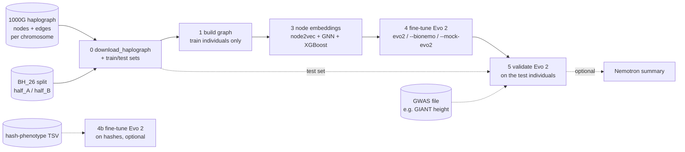

# GenoPheno Embedding Validator: documentation

The repository is a pipeline in two parts:

- **Part 1, [`part1_haplograph/`](part1_haplograph/):** 1000 Genomes haplograph → node embeddings (node2vec, GNN, XGBoost) → fine-tuning Evo 2 → validation of the fine-tuned Evo 2 on held-out test individuals. Most of this document is about part 1.
- **Part 2, [`part2_proteomics/`](part2_proteomics/):** paired tumor/normal proteomics → protein embeddings (ProLM) → fusion with the genome model. See [section 9](#9-part-2-proteomics) and the READMEs in its folders.

The short version is in [README.md](README.md). **How to install the dependencies and run the pipeline is at the end: [section 10](#10-installation) and [section 11](#11-running-the-pipeline).**

Contents: [1 What part 1 does](#1-what-part-1-does) · [2 The haplograph](#2-key-concepts-the-haplograph) · [3 Working directory](#3-working-directory-structure) · [4 Script reference](#4-script-reference) · [5 Split and leakage](#5-the-traintest-split-and-leakage-protection) · [6 GPU acceleration](#6-gpu-acceleration-rapids-cupy-bionemo-nemotron) · [7 Extending](#7-extending-the-pipeline) · [8 Limitations](#8-limitations-and-known-issues) · [9 Part 2](#9-part-2-proteomics) · [10 Installation](#10-installation) · [11 Running](#11-running-the-pipeline)

## 1. What part 1 does

The pipeline turns the [1000 Genomes haplograph](https://data.haploblocks.org/haplograph/1000G/) into a form Evo 2 can learn from, fine-tunes Evo 2 on it using the training individuals, and validates the fine-tuned model on the test individuals.



| Step | Script | In one sentence |
|---|---|---|
| 0 | `download_haplograph.py` | Downloads the haplograph (all chromosomes or a selection), checks it, and writes the training and test sets of individuals. |
| 1 | `1_build_graph.py` | Builds one graph (genome-wide or selected chromosomes), with edge weights computed from the training individuals. |
| 3 | `3_node_embeddings.py` | Turns every graph node into a vector with node2vec, a GNN and XGBoost (no labels); `--rapids` runs the SVDs on the GPU. |
| 4 | `4a_finetune_evo2_embeddings.py` | Fine-tunes Evo 2 7B on each training individual's sequence of node embeddings (no DNA); `--bionemo` runs Evo 2 through NVIDIA BioNeMo. |
| 4b | `4b_finetune_evo2_hash.py` | Optional, independent of steps 0–3: fine-tunes Evo 2 to predict a phenotype from a genomic hash (0/1 string). |
| 5 | `5_validate_evo2.py` | Validates one fine-tuned model on the test individuals (the model's own predictions, cluster consistency, GWAS enrichment, leakage, plus your own checks). |

There is no step 2: the former `2_ancestry_labels.py` was removed after the hackathon, because the pipeline no longer uses ancestry labels. The step numbers are kept so the scripts keep the names used in the README.

Shared code: `haplo_common.py` (downloads, individual lists, training set, device selection, synthetic test data) and `evo2_model.py` (the Evo 2, BioNeMo and mock backbones, the new layers and loss, and `load_finetuned`, which rebuilds a fine-tuned model for step 5).

## 2. Key concepts: the haplograph

The haplograph describes how haplotype patterns are shared across the 2,548 individuals of the 1000 Genomes data. There is one set of files per chromosome (chr1–chr22; chrX and chrY are not in the dataset).

**Nodes.** Each chromosome is divided into **haploblocks**, consecutive stretches written as `chr21_14215892-14284114` (chromosome, start and end in bp). Within each haploblock, the individuals' haplotypes are grouped into **clusters** of similar patterns. Each cluster is one node, with an id such as `chr21_14215892-14284114_cluster1`.
- Every node records its **carriers**: the individuals who carry that cluster, as one 0/1 column per individual.
- The number of carriers is the cluster's **support**. Most clusters are rare: on chr21 the median support is 1 (166,754 clusters in 597 haploblocks).

**Edges.** An edge connects two clusters on the **same chromosome** that are carried by the same individuals; there are no edges between chromosomes. Its raw **weight** is the number of individuals carrying both clusters. The dataset's edge files only list clusters with `min(support, N − support) ≥ 25`, so rare clusters have no edges.
- Common clusters share many carriers just by chance, so the pipeline converts the weight to **lift**: how many times more often the two clusters occur together than expected if they were independent.

  ```
  lift = weight / (support_A × support_B / number of individuals)
  ```

- A lift of 1 means chance level; above 1 means the clusters tend to be inherited together. The dataset README recommends lift over raw counts.
- In the pipeline's graph, each edge stores `log(1 + lift)`. Edges below `--min-lift` are dropped. Weight, support and lift are counted over the training individuals only.

## 3. Working directory structure

Everything is written under one root folder, `haplograph/` by default (`--workdir` of steps 0 and 1), inside the folder you run the scripts from. A **graph folder** holds one graph and everything derived from it; steps 3–5 point at it with `--graph-dir`.

```
haplograph/
├── raw/                               step 0 downloads (largest part)
│   ├── checksums.md5, verified.json     (files already MD5-checked: re-runs skip re-hashing them)
│   ├── chr1/ nodes.csv.gz, edges.csv.gz [, edges_lift_above_threshold.csv.gz]
│   └── ...
├── splits/                            step 0
│   ├── train_individuals.txt          TRAINING set, one sample ID per line
│   ├── test_individuals.txt           TEST set
│   ├── split.json                     split name, source, sizes, set ids
│   └── half_A.txt, half_B.txt         (BH_26 originals)
├── parts/                             per-chromosome cache (step 1), reused across graphs
│   └── chr1/ nodes.npz, carriers.npz, edges_all_minlift2_train-<id>_<raw file id>.npz   (re-parsed when the raw file changes)
└── genome_train_half_A/               one GRAPH FOLDER  (= --graph-dir for steps 3-5)
    ├── nodes.csv.gz, individuals.txt, carriers.npz, graph.npz, graph_info.json    step 1
    ├── train_individuals.txt, test_individuals.txt                                step 1
    ├── features_svd128_<set id>_<graph id>[_rapids].npy   step 3 (cache)
    ├── node_emb_<method>.npy / .json            step 3 (+ .csv.gz with --csv)
    ├── evo2[_bionemo|_mock]_next_<method>.pt    step 4
    └── validation_<model name>/                 step 5
        ├── report.md, summary.json, split.csv
        ├── test_set_performance_chroms.csv
        ├── cluster_consistency_regions.csv.gz
        ├── gwas_enrichment_<label>_regions.csv.gz
        ├── nemotron_summary.md                  (--nemotron-summary)
        └── inputs/downloads/<URL hash>/         split files downloaded by step 5
```

Graph folder names: `genome` (all 22 chromosomes) or e.g. `chr21_chr22` (a selection), plus `_train_<split name>` (`half_A` for BH_26, e.g. `random50_seed0` for a random split, or the stem of a `--train-individuals` file). Step 4b writes its model next to its input TSV.

## 4. Script reference

Only the main options are listed; `--help` shows all of them, and each script's header documents its output formats (input formats are in this section). Every script has **`--test`**, which runs it on a small synthetic haplograph (2 chromosomes, 60 individuals) on the CPU in seconds; the test outputs go to `<system temp>/haplograph_selftest/`. Steps 3–4 accept `--train-individuals` (a file or URL, one sample ID per line) and `--sample-map` (CSV: graph name, sample ID; only needed if the graph's individual names differ from the sample IDs); the training set defaults to the graph's `train_individuals.txt`.

### Step 0: `download_haplograph.py`

Downloads `nodes.csv.gz` and the edge file of each chromosome from `https://data.haploblocks.org/haplograph/1000G/<chrom>/`, checks them against `checksums.md5`, and writes the train/test split restricted to the individuals of the haplograph.

- **Out:** `raw/<chrom>/…`, `splits/train_individuals.txt`, `splits/test_individuals.txt`, `splits/split.json`.

| Option | Default | Meaning |
|---|---|---|
| `--chroms` | all (chr1–chr22) | e.g. `chr21,chr22` or `21,22` |
| `--edges` | `all` | `lift5` = small pre-filtered file (lift ≥ 5); `both` |
| `--split` | `bh26` | BH_26 halves (`half_A` train, `half_B` test); `random` = new split |
| `--test-fraction`, `--seed` | `0.5`, `0` | random split; stratified by 1000G population unless `--no-stratify` |
| `--workdir` | `haplograph` | output root |
| `--no-verify` | off | skip the MD5 check |

### Step 1: `1_build_graph.py`

Merges the chromosomes into one graph. Edge weights, support and lift come from the training individuals only (the split of step 0, or `--train-individuals`); `--no-split` uses all individuals. When `--train-individuals` is the split's own `train_individuals.txt`, the split's test file is used too; for any other training file pass `--test-individuals`, or step 5 will ask for it.

If the graph folder already exists, step 1 compares the requested settings (chromosomes, `--edges`, `--min-lift`, training and test sets) with its `graph_info.json`: identical settings reuse the graph, different ones stop with the differences listed. `--force` rebuilds in place (steps 3 and 4 then notice the new build and recompute / refuse stale outputs), `--out` writes a new folder.

- **In:** step 0's `raw/` and `splits/`:
  - `nodes.csv.gz` has columns `id`, `high_dim_edge` (the haploblock), then one 0/1 column per individual;
  - `edges.csv.gz` has columns `source`, `target`, `weight`.
- **Out** (in the graph folder):
  - `nodes.csv.gz`: columns `node`, `id`, `chrom`, `region`, `start`, `end`, `support`, and `support_train`;
  - `individuals.txt`: one individual per line;
  - `train_individuals.txt`, `test_individuals.txt`: the training and test individuals found in the graph;
  - `carriers.npz`: sparse [nodes × individuals], all individuals;
  - `graph.npz`: sparse [nodes × nodes], `log(1 + lift)`;
  - `graph_info.json`: settings, counts and the training / test sets.

| Option | Default | Meaning |
|---|---|---|
| `--chroms` | every downloaded chromosome | e.g. `chr21,chr22` |
| `--train-individuals` | the split of step 0 | training set file or URL |
| `--no-split` | off | build from all individuals |
| `--min-lift` | `2.0` | drop weaker edges |
| `--edges` | `all` | `lift5` = small pre-filtered file (not train-only) |
| `--workdir`, `--raw-dir`, `--out` | `haplograph`, `<workdir>/raw`, automatic | locations |
| `--cudf` | off | read and match nodes/edges on the GPU with RAPIDS cuDF |
| `--chunksize` | `2000000` | edge rows read at a time; `0` = whole file (with `--cudf`, needed for GPU parsing) |

### Step 3: `3_node_embeddings.py`

Learns one vector per node, by default with all three methods (`--method all`, or e.g. `--method gnn,xgboost`). No labels are used.

| Method | Uses | How |
|---|---|---|
| `node2vec` | graph | random walks along edges, then skip-gram (nodes close on walks get similar vectors) |
| `gnn` | graph + carrier features | 2-layer graph convolutional network trained to predict which nodes are connected |
| `xgboost` | graph + carrier features | trees predict each node's **haploblock region** (regions in genomic order grouped into `--xgb-region-bins` bins of about equal node count); the leaves a node falls into become its vector |

- **In:** `graph.npz`, plus `carriers.npz` (gnn, xgboost) and `nodes.csv.gz` (xgboost).
- **Out:**
  - `node_emb_<method>.npy`: float32 [nodes × dim], row *i* = node *i*;
  - `node_emb_<method>.json`: settings, a training summary (e.g. XGBoost accuracy vs the majority-class baseline), the training set and the graph build (`graph_id`, a hash of `graph_info.json`);
  - `node_emb_<method>.csv.gz` with `--csv`.

| Option | Default | Meaning |
|---|---|---|
| `--method` | `all` | `node2vec`, `gnn`, `xgboost`, a comma-separated list, or `all` |
| `--dim` | `64` | embedding size |
| `--p`, `--q` | `1.0`, `1.0` | node2vec: low `p` keeps walks local, low `q` makes them explore |
| `--walks-per-node`, `--walk-length` | `10`, `40` | node2vec walk budget (CPU-bound) |
| `--gnn-epochs` | `300` | GNN training length |
| `--xgb-trees`, `--xgb-depth` | `50`, `6` | boosting rounds and tree depth; the model has `--xgb-trees` × bins trees |
| `--xgb-region-bins` | `16` | number of genomic bins = XGBoost classes |
| `--device` | cuda if available | `cpu` / `cuda` for torch and XGBoost |
| `--rapids` | off | carrier and leaf SVDs on the GPU with RAPIDS cuML + CuPy (see section 6) |

If XGBoost runs out of memory, lower `--chunk-nodes`, `--xgb-svd-nodes`, `--xgb-train-nodes`, `--xgb-max-bin`, `--xgb-region-bins`, `--xgb-trees` or `--xgb-depth`. Step 3 moves the booster to the CPU before computing leaves, which avoids XGBoost's slow GPU/CPU device-mismatch path.

### Step 4: `4a_finetune_evo2_embeddings.py`

Fine-tunes Evo 2 7B on node embeddings, with no DNA involved. One example is one individual on one chromosome: their clusters in genomic order, each replaced by its embedding.
- The embeddings are projected into Evo 2 in place of its DNA-letter embeddings, plus a learned per-chromosome vector. Each embedding first gets a **genomic-position encoding** appended (sin / cos of the cluster's start at `--pos-freqs` wavelengths from 10 kb to the graph's largest start coordinate, standardized like the embedding; unknown starts get 0), used both as input and in the candidate keys the head is scored against. Node embeddings describe carrier and linkage structure, not location, so without it the model cannot tell which region comes next. Positive control (`tests/test_iteration3.py`: synthetic data, mock backbone, 60 epochs, 317 predictions on step 4's validation individuals): top-1 0.48 with the encoding vs 0.11 without, against a bigram of 0.53; on the graph's test half, never used for the graph or embeddings: 0.51 vs 0.13, bigram 0.52 (641 predictions).
- Evo 2 runs up to its read-out layer. Its last `--train-blocks` blocks before it are fully fine-tuned; the rest stay frozen. Evo 2 is kept in bf16, so the optimizer steps on fp32 master copies of the unfrozen weights and writes them back after every step (updating bf16 weights in place at `--lr 1e-5` would round every update away).
- Step 4 refuses embeddings made from an earlier build of the graph (different `graph_id`) or another training set.
- Rare clusters: most clusters are carried by one person, and 38.6% of chr21 clusters never occur in the training half, so predicting their identity is impossible. `--min-support` merges rare clusters into one "rare cluster of this region" token, counting carriers among step 4's own training individuals (not its validation individuals). The default `2` also merges clusters with one training carrier, so the token occurs in training and can be learned (at `1` it never would: on chr21 0 of 559 merged tokens are learnable, at `2` 550 of 567). A region whose rare clusters were all unseen in training still has an unlearnable token. `test_set_performance` reports the share of test targets that are merged tokens.
- Objective: predict the next token along the chromosome (cosine similarity to every token of that chromosome, i.e. its clusters after `--min-support` merging, softmax with `--temperature`).
- Only training individuals are used, split again into train and validation (`--val-frac`).

| Backbone | Flag | Notes |
|---|---|---|
| Evo 2 via the `evo2` package | (default) | one CUDA GPU (80 GB recommended); `--evo2-model`, `--layer` |
| Evo 2 via NVIDIA BioNeMo | `--bionemo` | **experimental, not yet run on a GPU**; inside the BioNeMo container, NeMo2 checkpoint in `--ckpt-dir`, `--model-size` (default `7b`), `--layer-index` (default `28`); code that may need adjusting for your BioNeMo version is marked `VERSION-SENSITIVE` in `evo2_model.py` |
| small stand-in model | `--mock-evo2` | a random causal transformer (`--mock-hidden`, `--mock-layers`), runs on CPU; **not Evo 2**, only for checking the pipeline |

- **In:** `nodes.csv.gz`, `individuals.txt`, `carriers.npz`, `node_emb_<method>.npy` + `.json`.
- **Out:** `evo2[_bionemo|_mock]_next_<method>.pt`, a torch dict (CPU tensors) containing:
  - `trained_blocks`: the fine-tuned backbone weights (the whole stand-in model for `--mock-evo2`);
  - `proj_in`, `chrom_emb`, `head`: the new layers;
  - `backend`, `graph_method`, `chroms`, `embeddings_sha1` and the backbone settings;
  - `train_individuals`, `val_individuals`, `train_set_id`;
  - `metrics` (validation before / after training) and `config`.

| Option | Default | Meaning |
|---|---|---|
| `--method` | required | which embeddings |
| `--train-blocks` | `4` | backbone blocks to fine-tune; `0` = frozen baseline (only the new layers train) |
| `--lr`, `--head-lr` | `1e-5`, `1e-3` | learning rates of the backbone blocks and the new layers |
| `--batch` | `8` | sequences per optimizer step (gradient accumulation, one sequence per forward pass) |
| `--max-len` | `1024` | max clusters per sequence (memory grows with it × the clusters on the chromosome) |
| `--epochs` | `1` | passes over the training sequences |
| `--chroms` | all of the graph | train on some chromosomes only |
| `--pos-freqs` | `16` | genomic-position encoding (sin/cos at this many wavelengths); `0` = embeddings only |
| `--min-support` | `2` | clusters carried by fewer of step 4's training individuals share one token per haploblock region (embedding = mean of its members); `0` = no merging. On chr21 (1,127 training individuals): 166,754 tokens without merging, 95,874 at `1`, 29,034 at `2`, 10,965 at `5` |

### Step 4b: `4b_finetune_evo2_hash.py` (optional)

Fine-tunes Evo 2 to predict a phenotype from a genomic hash. Each bit of the hash is one Evo 2 token.
- Numeric phenotypes are treated as regression (reports RMSE, Pearson r and R²).
- Text labels are treated as classification (reports accuracy).

- **In:** a TSV with two columns, the hash (0/1 string) and the phenotype, with an optional header row. Build it from training individuals only.
- **Out:** `evo2_hash_<phenotype>.pt` next to the TSV.

| Option | Default | Meaning |
|---|---|---|
| `--hash-pheno` | required | input TSV |
| `--task` | `auto` | `regression` or `classification` |
| `--hash-window` | `4096` | bits per Evo 2 pass; longer hashes are split |
| `--mock-evo2` | off | CPU stand-in model instead of Evo 2 |

### Step 5: `5_validate_evo2.py`

Validates one fine-tuned model on the test set. By default it uses the graph folder's `train_individuals.txt` / `test_individuals.txt` (from steps 0–1; a graph with a training set but no test file is refused rather than paired with another split, and only a `--no-split` graph falls back to BH_26); `--splits DIR_OR_URL` reads `half_A.txt` / `half_B.txt` from elsewhere (e.g. the [BH_26 folder](https://data.haploblocks.org/BH_26/splits/)), and `--splits none` uses the model's own validation individuals. It warns if any test individual was used to build the graph or to train or validate the model (when the checkpoint records its individuals, as every current step-4 checkpoint does). With `--splits none` the train side is the model's own training individuals. The checks to run are listed in a tasks file, one per line ([`validation_tasks.txt`](part1_haplograph/validation_tasks.txt)):

```
model_info
test_set_performance max_examples=500 train_examples=200
embedding_cooccurrence min_lift=2 min_support=5 min_expected=5 pairs=50000
cluster_consistency permutations=200
gwas_enrichment gwas=height_hg38.tsv pvalue=5e-8 label=height
```

| Task | Checks |
|---|---|
| `model_info` | model type and backbone, stored metrics, train/test leakage |
| `test_set_performance` | **queries the fine-tuned model** on the test individuals: next-cluster cross-entropy, perplexity, top-1 / top-5 accuracy per chromosome, top-1 within the target's own region; 95% CIs from a paired bootstrap over test individuals (model, bigram, model − bigram); the bigram conditional entropy of the training sequences as a reference cross-entropy (not a floor: a model with more context can go below it); the same on a sample of training individuals (generalization gap); a bigram baseline (most frequent next cluster after the current one, counted on the training individuals) that the model should beat; the stored validation metrics. Needs the backbone used in step 4 (a GPU for Evo 2 / BioNeMo) |
| `embedding_cooccurrence` | **held-out test of the step-3 embeddings, no GPU**: for distinct cluster pairs in different regions (≤ `max_distance` bp apart, ≥ `min_support` test carriers each, ≥ `min_expected` co-carriers expected among the test individuals, so that one chance co-carrier of two rare clusters can't make a pair "linked"), ROC AUC of embedding cosine similarity for pairs that co-occur among the TEST individuals (lift ≥ `min_lift`) vs pairs that don't (lift ≤ 1); overall, within distance bins and within frequency bins, with a 95% CI that resamples haploblock regions; references: genomic proximity, cluster frequency, and the lift counted on the training individuals. Warns when the graph was built with test individuals |
| `cluster_consistency` | per haploblock: do train and test individuals carry the same clusters, at the same frequencies, compared with random splits of the same size? |
| `gwas_enrichment` | which haploblocks hold more GWAS hits than expected (positions must use the haplograph's genome build) |

- **In:** the model `.pt`, the graph folder, the split files.
- **Out:** in `validation_<model name>/`: `report.md`, `summary.json`, `split.csv`, one CSV per task, and `nemotron_summary.md` with `--nemotron-summary`.

| Option | Default | Meaning |
|---|---|---|
| `--model` | required | fine-tuned model |
| `--tasks` / `--task` | `model_info` + `test_set_performance` + `embedding_cooccurrence` + `cluster_consistency` | tasks file / one task line |
| `--gwas` | none | shortcut adding a `gwas_enrichment` line |
| `--splits` | `graph` | `graph`, a folder or URL with `half_A.txt` / `half_B.txt`, or `none` |
| `--plugins` | none | Python file(s) with extra tasks |
| `--cudf` | off | read GWAS files and other tables on the GPU with RAPIDS cuDF |
| `--nemotron-summary` | off | plain-language summary by an NVIDIA Nemotron model (section 6) |

`--list-tasks` shows every task with its parameters. The README explains how to get GIANT and GWAS Catalog data.

## 5. The train/test split and leakage protection

The pipeline is designed so the test individuals never influence anything that is trained:

| Step | What comes from the training individuals only | What still contains everyone, and why |
|---|---|---|
| 0 | (writes the split) | |
| 1 | edge weights, support, lift, `--min-lift` filtering | `carriers.npz` (step 5 needs test carriers); the list of candidate edge pairs comes from the dataset's edge file |
| 3 | carrier features (gnn, xgboost); the graph (all methods) | none |
| 4 | the individuals trained and validated on | none |
| 5 | (checks this, then evaluates on the test individuals) | |

Each step stores the training set's id and the graph build's id and the next step checks them: steps 3 and 4 refuse any training set other than the graph's own; step 4 stops if the embeddings came from another training set or graph build; step 3 recomputes automatically if the graph, training set or its settings changed; step 5 fails `test_set_performance` for a model trained on another graph build or other embeddings, and `embedding_cooccurrence` marks embeddings made from another training set as not held-out. Step 5 only loads checkpoints with `torch.load(weights_only=True)`, so a model file can't run code. To use a different split, rerun step 0 with other `--split` settings (or give step 1 another `--train-individuals` file); step 1 then creates a new graph folder.

## 6. GPU acceleration: RAPIDS, CuPy, BioNeMo, Nemotron

The pipeline detects the GPU itself (torch and XGBoost use CUDA when available; `--device cpu` forces the CPU). The NVIDIA tools are optional extras:

| Tool | Where | What it does |
|---|---|---|
| RAPIDS cuDF | steps 1 and 5, `--cudf` | runs their pandas code on the GPU (cuDF's pandas accelerator), falling back to the CPU for anything cuDF doesn't support. In step 1 add `--chunksize 0` so the edge files are parsed on the GPU |
| RAPIDS cuML + CuPy | step 3, `--rapids` | carrier-matrix SVD and XGBoost leaf-basis SVD on the GPU |
| XGBoost (CUDA) | step 3 | tree training on the GPU (`--device cuda`, automatic when available) |
| NVIDIA BioNeMo | step 4, `--bionemo` | loads and runs Evo 2 through NeMo 2 / Megatron Core |
| NVIDIA Nemotron (NIM) | step 5, `--nemotron-summary` | plain-language interpretation of the validation report |

**RAPIDS in step 3, honestly.** Step 3 is CPU/RAM-bound, not GPU-bound, so `--rapids` is not a large speedup: the dominant cost is the CPU-side chunked embedding of all ~11M genome-wide nodes, which `--rapids` does not change. It only accelerates the two SVDs; tree fitting uses XGBoost's own GPU path, the rest is numpy. The carrier SVD is fitted on a `--rapids-fit-rows` sample (default 150k) and applied in `--rapids-chunk` dense chunks (default 200k). The sampling is an approximation: on the genome run (with the former ancestry target) it gave val-accuracy 0.986 vs 0.992/0.993 for the exact CPU SVD. Raise `--rapids-fit-rows` (e.g. 300000) to close that gap; the carrier matrix has only ~1,250 training columns, so a larger sample is cheap. The cached features are stored separately for `--rapids` (`features_svd*_rapids.npy`), so the CPU and GPU SVDs never mix.

**Nemotron.** `--nemotron-summary` sends the task summaries of the report to an NVIDIA Nemotron model on an OpenAI-compatible NIM endpoint and writes the answer to `nemotron_summary.md`. Only aggregate numbers are sent: sample IDs (`HG…`/`NA…` and the graph's own individual names) and the directories of file paths are removed, and file names and GWAS column names are dropped. The key is only sent over https (or to localhost), and redirects are not followed. Defaults: `--nemotron-url https://integrate.api.nvidia.com/v1` (build.nvidia.com; or a self-hosted NIM) and `--nemotron-model nvidia/llama-3.3-nemotron-super-49b-v1` (change it if the catalogue has moved on). The API key is read from `$NVIDIA_API_KEY`. Without a key, or if the request fails, step 5 prints a warning and still writes its report.

## 7. Extending the pipeline

- **Another validation run** (other trait, threshold or settings): add a line to the tasks file.
- **A new validation check:** write a function in a plugin file and load it with `--plugins my_checks.py`.

  ```python
  @task("mean_clusters_per_individual", "Average number of clusters per test individual")
  def mean_clusters(ctx, min_support: int = 1):
      n = ctx.graph.carriers[:, ctx.test_idx].sum(axis=0)
      return {"summary": {"mean": float(n.mean())}}
  ```

  A task receives `ctx` plus its parameters (typed by their annotations) and returns a `summary` dict, plus optional `notes` and `files`. Useful parts of `ctx`:
  - `ctx.graph.nodes`, `ctx.graph.carriers`, `ctx.graph.regions`;
  - `ctx.train_idx`, `ctx.test_idx`;
  - `ctx.model.meta`: the checkpoint dict;
  - `ctx.out(name)`: a path for an output file.
- **A check that queries the fine-tuned model:** `model, data = evo2_model.load_finetuned(ctx.model.meta, ctx.graph.dir)` rebuilds it; `model.logits(chrom, individual_index)` gives next-cluster logits and targets (see `test_set_performance`).
- **A new backbone** (another DNA foundation model): write a runner class in `evo2_model.py` with `net`, `dev`, `hidden_in`, `hidden_out`, `trainable` and `run_soft()` (see `MockEvo2Runner` for the smallest example), and select it in `make_runner()` and `load_finetuned()`.
- **A new model type in step 5:** add a rule to `model_kind()`.
- **A new embedding method:** write `embed_<name>(args, A)` in step 3 that returns a [nodes × dim] array and a summary dict, add it to `METHODS` and the dispatch dict in `run_method()`, and to the `--method` choices of step 4.
- **Another dataset:** change `BASE_URL` and `ALL_CHROMS` in `haplo_common.py` (same file layout), or put the files in `<workdir>/raw/<chrom>/` yourself together with `splits/split.json`, `train_individuals.txt` and `test_individuals.txt`.

## 8. Limitations and known issues

### What has and has not been run

On a CPU-only machine (Apple M5, 16 GB RAM, Python 3.9, torch 2.8, xgboost 2.1), the whole pipeline ran on the real chr21 data with the BH_26 split (1,252 train / 1,251 test individuals):

| Step | Result | Time |
|---|---|---|
| 0 | chr21 downloaded (~85 MB), MD5 verified, split written (45 haplograph individuals in neither half) | ~1 min |
| 1 | 166,754 nodes, 1,520,370 edges, 161,937 isolated nodes at `--min-lift 2` | 26 s |
| 3 | node2vec, GNN and XGBoost embeddings, CPU, reduced settings (`--walks-per-node 2 --walk-length 20 --window 3 --gnn-epochs 50 --xgb-trees 20 --xgb-depth 4`) | 94 s |
| 4 | `--mock-evo2 --max-len 128`, 1 epoch: validation loss 12.7 → 9.5 | 68 s |
| 5 | split consistent (3.7% of regions outside the 95% interval), no leakage; `test_set_performance` on 300 test sequences (bigram baseline top-1 accuracy 0.41) | ~15 s |

Every script's `--test` also passes, and step 5 rebuilds a step-4 model exactly (the same validation accuracy as stored in the checkpoint, when step 4 evaluated all its validation sequences, i.e. at most `--val-examples` of them; otherwise step 4 evaluated a random subset). **Not run, because no GPU was available:** Evo 2 itself (the `evo2` package), the BioNeMo backbone (written against the BioNeMo API, never executed), RAPIDS `--cudf` / `--rapids`, XGBoost on CUDA, `install_evo2.sh` beyond a syntax check, and the Nemotron request against the real NVIDIA endpoint (tested against a local fake endpoint). Expect to fix small API or version issues on first real runs, especially in the parts marked `VERSION-SENSITIVE`.

Earlier versions of this document described LoRA adapters, `--micro-batch` and activation checkpointing for step 4. They were never implemented: step 4 fine-tunes whole blocks, one sequence per forward pass.

### Modelling assumptions

- **Evo 2 was trained on DNA, never on these inputs.**
  - Step 4 replaces its nucleotide inputs with projected graph embeddings, and 4b feeds 0/1 characters. Neither is something Evo 2 has seen.
  - What is tested is whether its architecture and weights are a useful starting point. Its DNA knowledge doesn't transfer directly.
  - Always compare with a `--train-blocks 0` baseline and with the bigram baseline of `test_set_performance`. On chr21 the bigram baseline already reaches 41% top-1 accuracy (44% with the default `--min-support 2`).
  - The learning setup passes a positive control on synthetic data (the mock backbone reaches 0.9 × the bigram's top-1, see step 4). On chr21, 3 CPU epochs of the small mock reached test top-1 0.041 with the position encoding vs 0.010 without, still far below the bigram's 0.44: whether Evo 2 gets there needs a GPU run with a real training budget.
- **Edges exist only within chromosomes.** The genome-wide graph is 22 disconnected pieces.
  - node2vec vectors can't be compared across chromosomes; step 4 adds a per-chromosome vector to compensate.
  - Training sequences are per chromosome; there's no genome-wide sequence per person.
- **Most nodes are rare and isolated.** On chr21, 97% of the nodes have no edge at `--min-lift 2` (the dataset lists edges only for clusters with support ≥ 25), so node2vec and the GNN learn little for them beyond their carrier features.
- **XGBoost predicts the haploblock region.** On chr21 it reached only 0.070 accuracy on 16 region bins against a 0.066 majority baseline: the carrier profile of a rare cluster says little about where it is. The XGBoost embeddings may therefore carry little signal; compare them with node2vec and GNN in step 5.
- **Embeddings on held-out individuals (chr21).** `embedding_cooccurrence` (pairs with ≥ 5 expected test co-carriers) gave AUC 0.978 for GNN, 0.968 for XGBoost and 0.881 for node2vec (reduced CPU settings), against 0.991 for the lift counted on the training individuals, 0.618 for genomic proximity and 0.354 for cluster frequency: for common clusters, all three embeddings carry linkage that replicates in unseen individuals. Rare clusters (most nodes) cannot be tested this way.
- **Clusters only seen in the test set** have embeddings, but the model never trained on them; step 5 counts them (61,892 on chr21).

### Data and leakage

- **Genome build.** The haplograph README doesn't state the build of its coordinates (the gene-to-haploblock map in `part2_proteomics/data/` uses hg38 blocks). GIANT 2022 is hg19, the GWAS Catalog GRCh38. A mismatch makes GWAS results meaningless; step 5 warns when most SNPs fall outside the haploblocks.
- **Candidate edge pairs.** The *list* of candidate pairs comes from the dataset's edge file, which was made from all individuals. Weights and filtering are train-only, but a pair only present because of test individuals may still be in the list (with a train weight of zero it is dropped).
- **`--edges lift5`** was pre-filtered on all individuals, so its pair selection saw the test set. Use `--edges all` in train-only mode.
- **`split.tsv`** in the BH_26 folder isn't used; only `half_A.txt` / `half_B.txt` are.
- **2,548 vs 2,503 individuals.** 45 graph individuals are in neither BH_26 half and are left out of training and validation.
- **Step 4b's hash file** must be built from training individuals by the user; the pipeline can't check it.

### Statistical caveats in step 5

- **Chi-square assumption.** The chi-square test treats carrier counts as independent, but one person can carry two clusters of the same haploblock. The permutation-based columns don't rely on that and are the ones to trust.
- **The overall GWAS test.** The haploblocks seem to tile whole chromosomes, so almost every SNP falls inside one and the overall test can't show enrichment. Step 5 says so when this happens; use the per-haploblock results.
- **Overlapping haploblocks.** A SNP in an overlap (or with `window` > 0) is counted for one haploblock only.
- **`test_set_performance`** evaluates the central `--max-len` window of each sequence (the same windows as step 4's validation) on a sample of `max_examples` sequences; raise it for tighter estimates.

### Scale and performance

- **Data size.** The full edge files are up to about 1 GB per chromosome; genome-wide graphs need lots of memory and disk. Use `--min-lift` to shrink the graph, and `--chunksize` if memory runs out while reading edges.
- **Host RAM, not the GPU, is the bottleneck of steps 1–3** at genome scale (11M nodes). XGBoost's leaf stage is the peak; see the README's whole-genome notes.
- **GNN memory.** The GNN runs on the whole graph at once on one device; very large graphs may not fit.
- **node2vec speed.** Its walks run on CPU (numpy), which can be slow for genome-wide graphs; lower `--walks-per-node` or `--walk-length`.
- **Step 4.** It uses one GPU and can't resume an interrupted run. Each position is scored against all tokens of its chromosome, so memory grows with `--max-len` × the chromosome's tokens (chr21: 166,754 clusters, 29,034 tokens at the default `--min-support 2`); lower `--max-len` for large chromosomes.
- **Permutation cost.** Step 5's permutations multiply runtime; lower `permutations` for quick runs.

## 9. Part 2: proteomics

Part 2's code is unchanged since the hackathon; each folder has its own README with installation and usage.

| Folder | What | Language |
|---|---|---|
| [`part2_proteomics/proteomics_prep/`](part2_proteomics/proteomics_prep/) | places proteins in haploblocks, tumor − normal per protein and patient, node/edge CSVs; example and testthat tests (`run_example.sh`, `run_tests.sh`) | R |
| [`part2_proteomics/synthtan_prolm/`](part2_proteomics/synthtan_prolm/) | converts the synthetic SynthTAN v0.1 cohorts to ProLM's input format | Python |
| [`part2_proteomics/proteomics_emb/`](part2_proteomics/proteomics_emb/) | ProLM fine-tuning from scratch, one embedding per patient (`finetune.py`, run from inside a ProLM install; notebook `finetune_on_synthetic_data.ipynb`) | Python |
| [`part2_proteomics/data/`](part2_proteomics/data/) | gene-to-haploblock map (GENCODE v50 on 39,074 hg38 blocks) | TSV |
| [`part2_proteomics/clinical_dashboard/`](part2_proteomics/clinical_dashboard/) | `ProteoOnset.html`, a clinical dashboard prototype | HTML |

The fusion with the genome model (early vs late fusion with the Evo 2 of part 1) is designed but not implemented; see the README.

## 10. Installation

Part 1 has a CPU core (all steps, with `--mock-evo2` in step 4) and GPU extras (Evo 2, BioNeMo, RAPIDS). Run everything from `part1_haplograph/`.

### 10.1 CPU only (any OS; checks the whole pipeline, no Evo 2)

```bash
cd part1_haplograph
python3 -m venv ~/haplograph-env && source ~/haplograph-env/bin/activate
pip install --upgrade pip
pip install -r requirements.txt          # numpy, pandas, scipy, torch, xgboost
python 5_validate_evo2.py --test         # runs steps 0-5 on synthetic data; should end with "report: ..."
```

On macOS, XGBoost needs the OpenMP runtime: `brew install libomp`. For a smaller CPU-only torch on Linux: `pip install torch --index-url https://download.pytorch.org/whl/cpu`.

### 10.2 GPU with Evo 2 (Linux, NVIDIA GPU, CUDA 12.8)

[`install_evo2.sh`](part1_haplograph/install_evo2.sh) installs the CUDA 12.8 toolkit (Ubuntu), a venv in `~/evo2-env` with torch 2.7.1 (cu128), flash-attn 2.8.0.post2 (compiled from source on Blackwell), the `evo2` package (light install, no Transformer Engine) and `requirements.txt`, then runs Evo 2's generation test:

```bash
cd part1_haplograph
bash install_evo2.sh                     # auto-detects the GPU (compute capability >= 8.0)
bash install_evo2.sh rtx                 # or force RTX PRO 6000 Blackwell (sm_120) / l40s (sm_89)
source ~/evo2-env/bin/activate
```

Options as environment variables: `PYTHON=python3.11`, `VENV=...`, `EVO2_SRC=...`, `EVO2_REF=<tag>` (pin the evo2 version; default `main`), `MAX_JOBS=8` (faster flash-attn compile), `SKIP_CUDA_TOOLKIT=1`, `SKIP_EVO2_TEST=1` (the test generates with `evo2_7b_base`, downloading its weights, ~15 GB). Requirements: Linux, Python 3.11 or 3.12, NVIDIA driver for CUDA 12.8 (≥ 570), an 80 GB GPU recommended for 7B. Manual equivalent:

```bash
pip install numpy pandas scipy torch xgboost
pip install flash-attn==2.8.0.post2 --no-build-isolation
pip install evo2
```

### 10.3 RAPIDS (cuDF, cuML, CuPy) in its own venv

**RAPIDS goes in its own venv; the Evo 2 environment stays clean.** Installing RAPIDS into the same site-packages can downgrade the CUDA bindings (`cuda-bindings`, `cuda-toolkit`) that a CUDA 13 PyTorch depends on to CUDA 12. On the hackathon machine PyTorch happened to keep working because it bundles its own CUDA libraries, but that is luck, not design. Keep two environments:

- **RAPIDS venv active** (`(rapids-env)` in the prompt): steps 1 and 5 with `--cudf`, step 3 with `--rapids`.
- **Evo 2 venv active**: step 4, and everything without RAPIDS flags.

Check the prompt before every run. Without conda, the CUDA 12 RAPIDS pip wheels (`-cu12`) are the route:

```bash
sudo apt install -y python3-venv             # if venv creation fails (needs sudo)
python3 -m venv ~/rapids-env
source ~/rapids-env/bin/activate
pip install --upgrade pip
pip install --extra-index-url=https://pypi.nvidia.com \
    "cudf-cu12==26.2.*" "cuml-cu12==26.2.*" "cupy-cuda12x==14.2.0" \
    -r requirements.txt
python -c "import cudf, cuml, cupy; print('cuml', cuml.__version__, '| gpu', cupy.cuda.runtime.getDeviceCount())"
# expect: cuml 26.02.000 | gpu 1
```

Versions verified at the hackathon (RTX PRO 6000 Blackwell, 96 GB, driver 580.126.09 / CUDA 13.0, `nvcc` 12.8, Python 3.10): `cudf-cu12 26.02.*`, `cuml-cu12 26.02.000`, `cupy-cuda12x 14.2.0`, `numpy 2.2.x`, `scipy 1.15.x`, CUDA-enabled `xgboost`.

If RAPIDS was already pip-installed into the system Python, remove it there (with the RAPIDS venv deactivated) and check that PyTorch still sees the GPU:

```bash
deactivate 2>/dev/null
pip uninstall -y cudf-cu12 cuml-cu12 cupy-cuda12x \
    libcudf-cu12 libcuml-cu12 pylibcudf-cu12 librmm-cu12 rmm-cu12 \
    libraft-cu12 pylibraft-cu12 libkvikio-cu12
python3 -c "import torch; print(torch.__version__, torch.cuda.is_available())"   # expect: ... True
# if that prints False or errors, restore the bindings PyTorch wants (CUDA 13 torch):
pip install --user --force-reinstall 'cuda-bindings>=13.0.3' 'cuda-toolkit==13.0.3'
```

### 10.4 BioNeMo (for `--bionemo`)

Run step 4 inside the BioNeMo Framework container, which provides torch, NeMo 2, Megatron Core and bionemo-evo2, and convert (or download) an Evo 2 checkpoint in NeMo2 format:

```bash
docker run --gpus all -it --rm -v "$PWD":/workspace -w /workspace/part1_haplograph \
    nvcr.io/nvidia/clara/bionemo-framework:<version> bash
pip install -r requirements.txt
evo2_convert_to_nemo2 --model-path hf://arcinstitute/savanna_evo2_7b_base --model-size 7b --output-dir nemo2_evo2_7b_8k
# or: download_bionemo_data evo2/7b-8k:1.0      (pre-converted checkpoint)
```

`--model-size` must match the checkpoint (`7b` = 8K context, `7b_arc_longcontext` = 1M context).

### 10.5 Nemotron (for `--nemotron-summary`)

Create an API key at [build.nvidia.com](https://build.nvidia.com) (or run a Nemotron NIM yourself and pass `--nemotron-url`), then `export NVIDIA_API_KEY=nvapi-...`. No extra Python package is needed.

## 11. Running the pipeline

All commands from `part1_haplograph/`.

### 11.1 Self-tests (CPU, seconds)

```bash
python download_haplograph.py --test        # synthetic haplograph + split
python 1_build_graph.py --test
python 3_node_embeddings.py --test
python 4a_finetune_evo2_embeddings.py --test   # --mock-evo2
python 4b_finetune_evo2_hash.py --test
python 5_validate_evo2.py --test            # runs all of the above, then every validation task
```

### 11.2 Real data on a CPU (chr21, stand-in model, about 5 minutes)

```bash
python download_haplograph.py --chroms chr21
python 1_build_graph.py
G=haplograph/chr21_train_half_A
python 3_node_embeddings.py --graph-dir $G --device cpu \
    --walks-per-node 2 --walk-length 20 --window 3 --gnn-epochs 50 --xgb-trees 20 --xgb-depth 4
python 4a_finetune_evo2_embeddings.py --method gnn --graph-dir $G --mock-evo2 --device cpu --max-len 128
python 5_validate_evo2.py --model $G/evo2_mock_next_gnn.pt --graph-dir $G --tasks validation_tasks.txt
```

The numbers of the stand-in model mean nothing; this only shows that the data flows through every step.

### 11.3 Real data on a GPU (Evo 2)

```bash
source ~/evo2-env/bin/activate
python download_haplograph.py                              # whole genome, BH_26 split (~15 GB)
python 1_build_graph.py                                    # -> haplograph/genome_train_half_A
G=haplograph/genome_train_half_A
python 3_node_embeddings.py --graph-dir $G                 # node2vec + gnn + xgboost (torch/XGBoost on CUDA)
for m in node2vec gnn xgboost; do
    python 4a_finetune_evo2_embeddings.py --method $m --graph-dir $G
    python 4a_finetune_evo2_embeddings.py --method $m --graph-dir $G --train-blocks 0 --out $G/evo2_frozen_next_$m.pt
done
for m in node2vec gnn xgboost; do
    python 5_validate_evo2.py --model $G/evo2_next_$m.pt --graph-dir $G --tasks validation_tasks.txt
done
```

Start with `--chroms chr21,chr22` in steps 0–1 (`G=haplograph/chr21_chr22_train_half_A`) before the whole genome. Compare each model with its frozen (`--train-blocks 0`) run and with the bigram baseline in `report.md`.

With RAPIDS (in the RAPIDS venv) for steps 1, 3 and 5:

```bash
source ~/rapids-env/bin/activate
python 1_build_graph.py --cudf --chunksize 0                       # add --force if the graph already exists
python 3_node_embeddings.py --graph-dir $G --device cuda --rapids --rapids-fit-rows 300000 --force
deactivate && source ~/evo2-env/bin/activate      # step 4 in the Evo 2 environment
```

With BioNeMo (inside the container, see 10.4):

```bash
python 4a_finetune_evo2_embeddings.py --method gnn --graph-dir $G --bionemo --ckpt-dir nemo2_evo2_7b_8k
python 5_validate_evo2.py --model $G/evo2_bionemo_next_gnn.pt --graph-dir $G --tasks validation_tasks.txt
```

With a Nemotron summary of the validation:

```bash
export NVIDIA_API_KEY=nvapi-...
python 5_validate_evo2.py --model $G/evo2_next_gnn.pt --graph-dir $G --tasks validation_tasks.txt --nemotron-summary
```

At genome scale, host RAM is the limit in steps 1–3 (see section 8 and the README's whole-genome notes); lower `--xgb-trees`, `--xgb-depth` or `--xgb-region-bins` if step 3 is killed.
